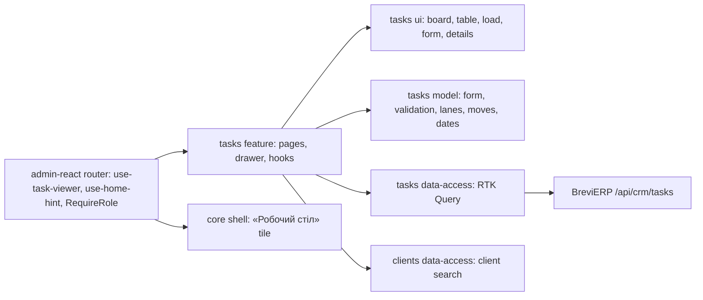

# Manager tasks: «Завдання менеджерам» and «Мої завдання»

**State:** implemented 2026-11-04, Admin React. Specification: [Admin manager tasks](../../specs/admin/tasks/001-manager-tasks/README.md); backend rules R-* in BreviERP `docs/sdd/specs/crm/004-manager-tasks/README.md`. Look: [«Цех»](../../standards/admin/design-system.md).

## Behavior and routes

| Route          | Purpose                                                                                     |
| -------------- | ------------------------------------------------------------------------------------------- |
| `/admin/tasks` | «Адміністрування › Завдання менеджерам» (Admin role): tabs «Завдання» and «Навантаження»    |
| `/crm/tasks`   | «Менеджер сервісу › Мої завдання» (Manager or Admin role): «На сьогодні», metrics, K2 board |

- Tab «Завдання»: metrics, search, filter chips and the table on the full width; a «Менеджер: …» chip shows and clears the manager filter. Tab «Навантаження» (L3): a row per manager with open, overdue, urgent, in progress, done in 7 days, % on time in 30 days and a bar; a row click opens «Завдання» for that manager.
- Director and Admin create, edit and delete tasks, and filter both pages by manager. On the board they see everyone's cards with avatars and can mark cards urgent by dragging.
- A Manager sees own tasks only (the server enforces it), drags cards to «У роботі» or «Виконано», and checks steps in the side panel.
- «Мої завдання» shows every open task and the tasks done in the chosen «Виконані за» period («Цей тиждень» from Monday by default, «Минулий тиждень», «Останній місяць», «Квартал», «Рік», «Усі»); every column is newest added first. The side panel of an open task has a green «Виконано» next to «Закрити»: it marks the task done and closes the panel (client corrections round 2, 2026-11-08).
- Both pages open the same side panel (`ReferenceEditorDrawer`): view with status, steps and history; the form for Director and Admin. In the view Director and Admin pick another manager in «Виконавець» to pass the task on at once (saved as an edit; history shows the transfer).
- A «Подзвонити» task made from a lead call (LEAD-001 R-08) shows «Лід» in the side panel with a link to the lead in «Мій день»; see [leads](leads.md).
- The sidebar «Робочий стіл» tile shows «Завдання: прострочено N · терміново M» from the overview, or a neutral line when nothing burns.

## Structure diagram



## Code structure

```text
apps/admin-react/src/app/router/
  use-task-viewer.ts               signed-in user → TaskViewer (Admin role manages all)
  use-home-hint.ts                 task overview → second line of «Робочий стіл»
  admin-route-definitions.tsx      tasksRoutes = createTasksRoutes({ useTaskViewer })
  create-admin-router.tsx          /admin/tasks behind Admin, /crm/tasks behind Manager or Admin
  legacy-menu.ts                   «Мої завдання», «Завдання менеджерам»
libs/admin/core/shell/src/navigation/menu/admin-home-tile.tsx   «Робочий стіл» tile (H2)
libs/admin/tasks/
  model/src/
    entities/manager-task.ts       task, lanes, overview, viewer
    forms/task-form.ts             side panel values, defaults, due time
    validators/                    form rules
    mappers/                       dates, labels, history text, board moves, home hint
  data-access/src/
    api/                           all /api/crm/tasks endpoints
    mappers/                       contract → model, form → save input
    errors/                        Ukrainian API messages
  ui/src/
    components/board/              board, lane, card, «На сьогодні»
    components/{metrics,load,status}/ metric strip, workload bar, state pill
    tables/                        server-paged tasks table, «Навантаження» table
    forms/                         form fields, steps editor
    details/task-details.tsx       view: status buttons, steps, history
    dialogs/task-delete-dialog.tsx
  feature/src/
    tasks.routes.tsx               route factory; returns admin and board routes
    pages/{admin,board}/           «Завдання менеджерам», «Мої завдання»
    components/{editor,list,board,notice}/ side panel, filter chips, manager filter, snackbar
    hooks/{editor,list,board,notice}/      panel state and actions, list, board and moves, notice
```

## Tests

- Model: `mappers/*.unit.test.ts`, `validators/*.unit.test.ts`. Run `npx nx test admin-tasks-model`.
- Data access: `mappers/task-input.mapper.unit.test.ts`. Run `npx nx test admin-tasks-data-access`.
- UI: `components/board/task-board.component.test.tsx`. Run `npx nx test admin-tasks-ui`.
- Feature: `pages/board/task-board-page.component.test.tsx` (own board for a Manager, manager filter for Admin), `pages/admin/manager-tasks-page.component.test.tsx` («Навантаження» row opens filtered «Завдання»). Run `npx nx test admin-tasks-feature`.
- Menu, routes and tile: `apps/admin-react/src/app/router/*.test.ts(x)` and `libs/admin/core/shell/src/layout/admin-layout.component.test.tsx`. Run `npx nx test admin-react -- src/app/router` and `npx nx test admin-core-shell`.
