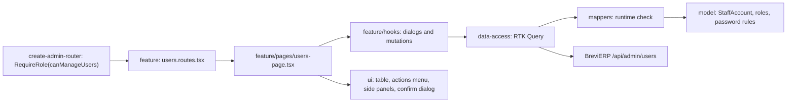

# Admin: «Користувачі» (staff accounts)

**Status:** implementation exists, checked 2026-11-03. [SDD](../../specs/admin/auth/002-cookie-sign-in/README.md); backend: BreviERP `docs/sdd/features/identity/staff-accounts.md`.

Admin and the director only: «Адміністрування → Користувачі» (`/admin/users`). The page lists staff accounts (name, email, role, status pill), creates a Director, Admin, Accountant or Manager in the right side panel (email, name, role, password of at least 8 characters), changes the role, blocks or unblocks, sets a new password and deletes an account. Role changes, blocking and deletion ask for confirmation; a new password and blocking end the user's sessions.

The row menu offers only what the backend allows (`model/queries/staff-permissions.ts`): one director (the Director role is off once one exists); an admin sees no actions on the director row; nobody blocks or deletes themselves; only the director changes their own role. The director's session holds both `Director` and `Admin`. A Manager or Accountant does not see the menu entry, and the URL shows «Немає доступу».

## Structure diagram



## Code structure

```text
libs/admin/users/
  model/src/
    entities/staff-account.ts           # account, roles and Ukrainian labels
    queries/staff-permissions.ts        # which row actions the signed-in user may take
    validators/staff-account-rules.ts   # email, name, password ≥ 8 (as the backend)
  data-access/src/
    api/admin-users.api.ts              # list, create, role, blocked, password, delete
    mappers/staff-account.mapper.ts     # checks the response before use
  ui/src/
    tables/                             # accounts table, row actions menu
    panels/                             # side panel, create user, new password
    dialogs/confirm-action-dialog.tsx   # «Змінити роль?», «Заблокувати?», «Видалити?»
    status/staff-status-pill.tsx        # «Активний» / «Заблокований»
  feature/src/
    users.routes.tsx                    # /admin/users, signed-in staff (ID, director) from the app
    pages/users-page.tsx
    hooks/                              # dialog state, confirmation texts
    errors/staff-error-message.ts       # server errors → Ukrainian text
```

## Tests

- `libs/admin/users/**/src/**/*.test.ts(x)`
- `apps/admin-react/src/app/router/navigation-config.unit.test.ts` (entry only for Admin)

Focused run: `npx nx run-many -t test -p admin-users-model,admin-users-data-access,admin-users-ui,admin-users-feature`.
