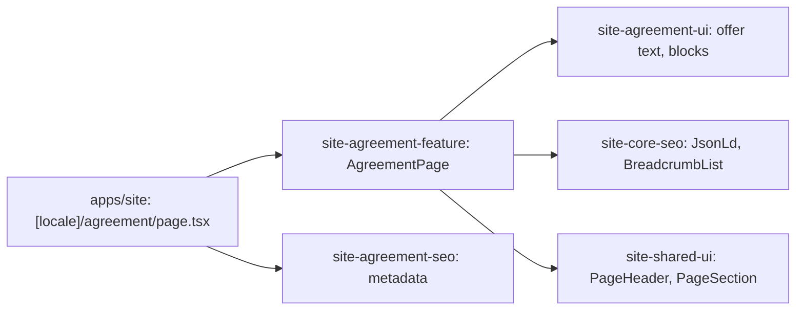

# Site: «Договір» page

**Status:** code exists, checked 2026-11-10. Specification: [«Договір» page](../../specs/site/agreement/001-agreement/README.md).

`/uk/agreement` and `/ru/agreement` show the public offer of sale: the preamble, a table of contents with anchors, eleven sections clause by clause, and the seller details. The offer is the text of the live `brevi.com.ua` page «Договір» in both languages without edits; the seller details come from `COMPANY` and show only the site phone. The footer links here with «Угода користувача». The page is static and reads no API.

## Structure diagram



## Code structure

```text
apps/site/src/app/[locale]/agreement/page.tsx  # route
libs/site/
├── agreement/feature/src/lib/agreement-page.tsx  # block order, links, JSON-LD
├── agreement/ui/src/lib/
│   ├── data/                                     # agreement-uk, agreement-ru: the offer; agreement-text: types
│   ├── i18n/agreement-dictionary.ts              # labels, text getter, section anchors
│   └── sections/                                 # contents, section, requisites
└── agreement/seo/src/lib/agreement-metadata.ts
```

## Tests

- `libs/site/agreement/ui/src/lib/agreement-ui.spec.tsx`
- `libs/site/agreement/feature/src/lib/agreement-page.spec.tsx`
- `libs/site/agreement/seo/src/lib/agreement-seo.spec.ts`

Run one project: `npx nx test site-agreement-ui`. All site libraries: `npm run test:site`.
