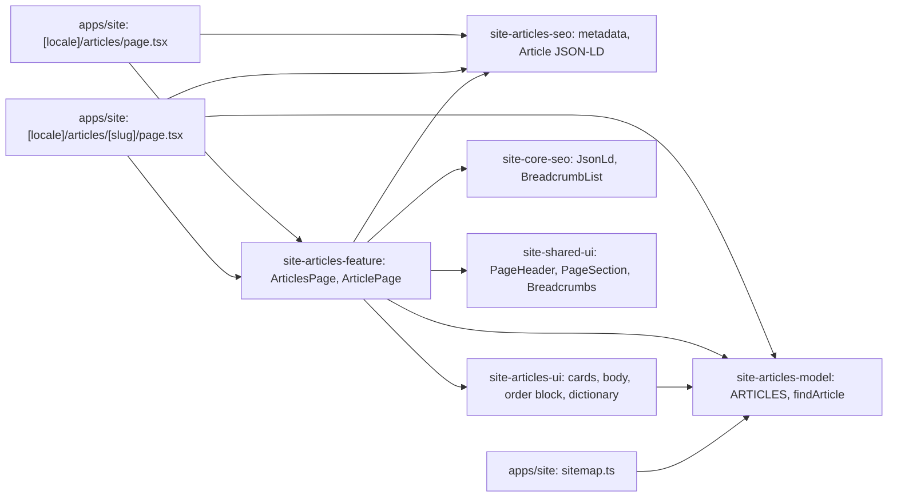

# Site: «Статті» pages

**Status:** code exists, checked 2026-11-10. Specification: [«Статті» pages](../../specs/site/articles/001-articles/README.md).

`/uk/articles` and `/ru/articles` list the 26 articles of the Brevi blog as cards (date, title, excerpt), newest first, without pagination. `/uk/articles/{slug}` and `/ru/articles/{slug}` show one article: breadcrumbs, title, date, text with lists and pictures, a call to order, and three more articles. The slug is the same in both languages. Texts and pictures are from the live `brevi.com.ua` blog in both its language versions; titles are set in sentence case. The pages are static and read no API: articles are files in `site-articles-model` until the admin gets an article editor. An unknown slug is a 404.

## Structure diagram



## Code structure

```text
apps/site/src/app/[locale]/articles/page.tsx          # list route
apps/site/src/app/[locale]/articles/[slug]/page.tsx   # article route, static params, 404 for other slugs
apps/site/public/assets/articles/                     # article pictures
libs/site/
├── articles/model/src/lib/
│   ├── article.ts                                    # Article, ArticleBlock
│   ├── data/<slug>.ts                                # one article per file, uk and ru
│   ├── article-files.ts                              # list of the files
│   └── articles.ts                                   # ARTICLES, findArticle, formatArticleDate
├── articles/ui/src/lib/
│   ├── i18n/articles-dictionary.ts
│   └── sections/                                     # article-cards, article-body, articles-order
├── articles/seo/src/lib/                             # articles-metadata, article-json-ld
└── articles/feature/src/lib/                         # articles-page, article-page, article-links
```

To add an article: create `data/<slug>.ts`, add it to `article-files.ts`; the list, the page, and the sitemap pick it up.

## Tests

- `libs/site/articles/model/src/lib/articles.spec.ts`
- `libs/site/articles/ui/src/lib/articles-ui.spec.tsx`
- `libs/site/articles/seo/src/lib/articles-seo.spec.ts`
- `libs/site/articles/feature/src/lib/articles-pages.spec.tsx`

Run one project: `npx nx test site-articles-model`. All site libraries: `npm run test:site`.
