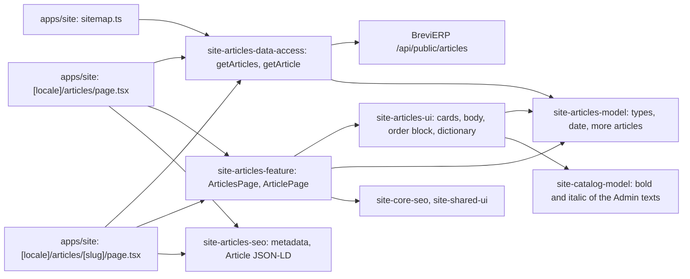

# Site: «Статті» pages

**Status:** code exists, checked 2026-11-11. Specification: [«Статті» pages](../../specs/site/articles/001-articles/README.md).

`/uk/articles` and `/ru/articles` list the articles staff mark «Показувати на сайті» in «Контент → Статті» as cards (cover, date, title, excerpt), newest first, without pagination. `/uk/articles/{slug}` and `/ru/articles/{slug}` show one article: breadcrumbs, title, date, text with headings, lists and pictures from the CDN, a call to order, and three more articles. The slug is the same in both languages. Articles come from the BreviERP public article API through `site-articles-data-access` and are kept five minutes; a new article opens without a rebuild. An article without Russian texts shows the Ukrainian ones on the Russian page with a canonical to the Ukrainian page. A hidden or unknown slug is a 404. With no articles or no API the list says they appear later.

## Structure diagram



## Code structure

```text
apps/site/src/app/[locale]/articles/page.tsx          # list route
apps/site/src/app/[locale]/articles/[slug]/page.tsx   # article route, dynamic params, 404 for hidden slugs
libs/site/
├── articles/model/src/lib/
│   ├── article.ts                                    # Article, ArticleCard, ArticleBlock, ArticlePhoto
│   └── articles.ts                                   # formatArticleDate, pickMoreArticles
├── articles/data-access/src/lib/
│   ├── articles-source.ts                            # getArticles, getArticle, getArticleAddresses
│   ├── articles-loaders.ts, articles-cache.ts        # cached reads, tag `articles`, lifetimes
│   └── mappers/public-articles.mapper.ts             # run-time checks of the API answers
├── articles/ui/src/lib/
│   ├── i18n/articles-dictionary.ts
│   └── sections/                                     # article-cards, article-body, article-inline, articles-order
├── articles/seo/src/lib/                             # articles-metadata, article-json-ld
└── articles/feature/src/lib/                         # articles-page, article-page, article-links
```

To add or change an article: «Контент → Статті» in the Admin; the list, the page, and the sitemap pick it up within five minutes.

## Tests

- `libs/site/articles/model/src/lib/articles.spec.ts`
- `libs/site/articles/data-access/src/lib/articles-source.spec.ts`, `mappers/public-articles.mapper.spec.ts`
- `libs/site/articles/ui/src/lib/articles-ui.spec.tsx`
- `libs/site/articles/seo/src/lib/articles-seo.spec.ts`
- `libs/site/articles/feature/src/lib/articles-pages.spec.tsx`

Run one project: `npx nx test site-articles-model`. All site libraries: `npm run test:site`.
