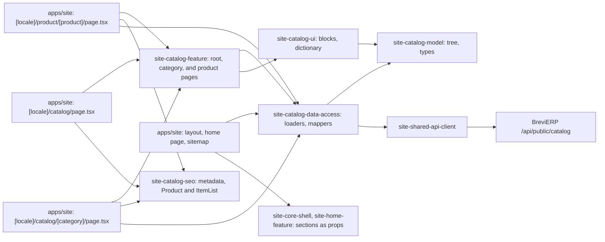

# Site: catalog, category, and product pages

**Status:** catalog root, category pages, and product pages read the BreviERP Admin, checked 2026-11-11. Specifications: [catalog, stage 1](../../specs/site/catalog/001-catalog/README.md), [product page](../../specs/site/catalog/002-product-page/README.md), [products from the Admin](../../specs/site/catalog/003-catalog-from-admin/README.md).

The catalog shows the products that staff mark «Показувати на сайті» in the Admin («Контент → Товари сайту»). The data comes from the anonymous BreviERP API `/api/public/catalog`; the site keeps no copy of its own.

`/uk/catalog` and `/ru/catalog` show the two product types («Спецодяг власного пошиття», «Засоби індивідуального захисту») with the sections of the Admin that have products on the site. `/{locale}/catalog/{slug}` is a category page of a type or of a section: breadcrumbs, heading with the number of models, links to sections, every product on one page (photo, name, lowest price «від»), and the order block. There is no sorting, filtering, or pagination.

`/{locale}/product/{slug}` is a product page: photos with thumbnails, the name, the model number, short facts, three prices by order size (of the chosen fabric for a sewing model), «Залишити заявку» and the phone, the description, the characteristics, four other models of the same category, and the order block. A product without a price shows «Дізнатися ціну». The site has no cart; the actions open the [request page](request.md).

Answers of the API are cached for five minutes (`'use cache'`, tag `catalog`, Workers KV, see [hosting](../../architecture/site/platform/hosting.md#cache)), so a change in the Admin reaches the site without a rebuild. When the API is unavailable the catalog is empty, a product is 404, and the answer is asked again in a minute. The same tree feeds the mega menu, the footer, the mobile bar, the home page, and the sitemap: the layout and the routes read it on the server and pass it down.

Section names are Ukrainian in both languages until «Контент → Розділи» exists. A product without Russian texts shows the Ukrainian ones on the Russian page, with the Ukrainian page as canonical.

## Structure diagram



## Code structure

```text
apps/site/src/app/[locale]/layout.tsx                   # reads the tree for the menus
apps/site/src/app/[locale]/catalog/page.tsx             # catalog root
apps/site/src/app/[locale]/catalog/[category]/page.tsx  # category; unknown slug is 404
apps/site/src/app/[locale]/product/[product]/page.tsx   # product; unknown slug is 404
apps/site/src/app/sitemap.ts                            # categories and products from the API
libs/site/
├── shared/api-client/src/lib/     # siteApiGet: GET of the public BreviERP API
├── catalog/model/src/lib/
│   ├── catalog-tree.ts            # tree type, path lookup
│   ├── catalog-types.ts           # names and slugs of the two product types
│   ├── catalog-category.ts        # category and product card types
│   ├── catalog-product.ts         # product page, fabrics, price tiers
│   └── catalog-sections.ts        # sections for menus and the home page
├── catalog/data-access/src/lib/
│   ├── catalog-source.ts          # what pages call: tree, categories, products, related
│   ├── catalog-loaders.ts         # cached reads of the API
│   ├── catalog-cache.ts           # cache tag and lifetimes
│   └── mappers/                   # run-time check of answers, API to site types
├── catalog/ui/src/lib/
│   ├── i18n/catalog-dictionary.ts # uk and ru text, price format
│   └── sections/                  # sections grid, subcategories, product grid, text, order,
│                                  # product gallery and prices (client), buy block, specs
├── catalog/seo/src/lib/           # catalog-metadata, catalog-product-seo
└── catalog/feature/src/lib/       # catalog-root-page, catalog-category-page, catalog-product-page
```

## Tests

- `libs/site/shared/api-client/src/lib/site-api.spec.ts`
- `libs/site/catalog/model/src/lib/catalog-sections.spec.ts`
- `libs/site/catalog/data-access/src/lib/catalog-source.spec.ts`
- `libs/site/catalog/data-access/src/lib/mappers/public-catalog.mapper.spec.ts`
- `libs/site/catalog/ui/src/lib/catalog-ui.spec.tsx`
- `libs/site/catalog/seo/src/lib/catalog-metadata.spec.ts`
- `libs/site/catalog/seo/src/lib/catalog-product-seo.spec.ts`
- `libs/site/catalog/feature/src/lib/catalog-pages.spec.tsx`

Run one project: `npx nx test site-catalog-ui`. All site libraries: `npm run test:site`.
