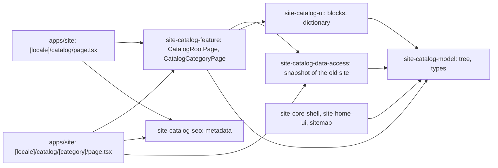

# Site: catalog and category pages

**Status:** catalog root and category pages exist, checked 2026-11-10; the product page is the next stage. Specification: [catalog, stage 1](../../specs/site/catalog/001-catalog/README.md).

`/uk/catalog` and `/ru/catalog` show the 13 catalog sections with their subsections. `/{locale}/catalog/{slug}` is a category page: breadcrumbs, heading with the number of models, links to subsections, the list of products (photo and name), the category text of the old site, and the order block. There are 65 category pages and 242 products. A category shows all its products on one page (the largest has 85); there is no sorting, filtering, or pagination.

The catalog shows no prices and has no cart (owner decisions of 2026-11-10): every product card has «Дізнатися ціну», which opens the [request page](request.md). Product cards are not links yet, because the product page does not exist.

The data is a snapshot of the old `brevi.com.ua` catalog taken on 2026-11-10, because BreviERP has no public catalog API yet. `site-catalog-data-access` is the only place that reads the snapshot, so switching to the API later does not touch the pages. The light category tree (names, slugs, counts) lives in `site-catalog-model` and feeds the mega menu, the footer, the mobile bar, the home page, and the sitemap.

## Structure diagram



## Code structure

```text
apps/site/src/app/[locale]/catalog/page.tsx             # catalog root
apps/site/src/app/[locale]/catalog/[category]/page.tsx  # category; unknown slug is 404
apps/site/public/catalog/products/                      # product photos (webp)
libs/site/
├── catalog/model/src/lib/
│   ├── catalog-tree.ts            # tree type, path lookup
│   ├── catalog-category.ts        # category and product card types
│   ├── catalog-sections.ts        # sections for menus and the home page
│   └── data/catalog-tree.ts       # generated tree
├── catalog/data-access/src/lib/
│   ├── catalog-source.ts          # getCatalogCategory, products, slugs
│   └── snapshot/                  # generated categories and products
├── catalog/ui/src/lib/
│   ├── i18n/catalog-dictionary.ts # uk and ru text
│   └── sections/                  # sections grid, subcategories, product grid, text, order
├── catalog/seo/src/lib/catalog-metadata.ts
└── catalog/feature/src/lib/       # catalog-root-page, catalog-category-page
tools/site-catalog-import/         # scripts that built the snapshot
```

## Tests

- `libs/site/catalog/model/src/lib/catalog-sections.spec.ts`
- `libs/site/catalog/data-access/src/lib/catalog-source.spec.ts`
- `libs/site/catalog/ui/src/lib/catalog-ui.spec.tsx`
- `libs/site/catalog/seo/src/lib/catalog-metadata.spec.ts`
- `libs/site/catalog/feature/src/lib/catalog-pages.spec.tsx`

Run one project: `npx nx test site-catalog-ui`. All site libraries: `npm run test:site`.
