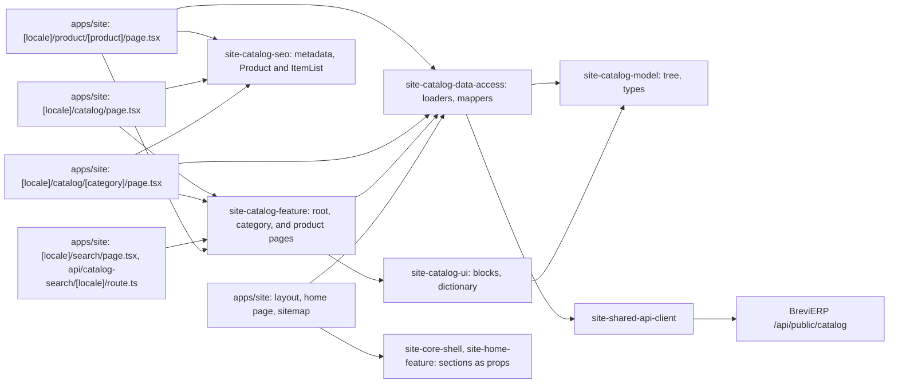

# Site: catalog, category, and product pages

**Status:** catalog root, category pages, and product pages read the BreviERP Admin, checked 2026-11-11. Specifications: [catalog, stage 1](../../specs/site/catalog/001-catalog/README.md), [product page](../../specs/site/catalog/002-product-page/README.md), [products from the Admin](../../specs/site/catalog/003-catalog-from-admin/README.md), [site categories from the Admin](../../specs/site/catalog/004-site-categories/README.md), [product page layout «Ціна поруч»](../../specs/site/catalog/005-product-page-layout/README.md), [search, tabs, and filters](../../specs/site/catalog/006-catalog-search-filters/README.md).

The catalog shows the categories staff keep in «Контент → Розділи сайту» and the products they mark «Показувати на сайті» in «Контент → Товари сайту». The data comes from the anonymous BreviERP API `/api/public/catalog`; the site keeps no copy of its own.

`/uk/catalog` and `/ru/catalog` show a large search field and the categories in two groups, «Власне пошиття» and «Засоби захисту», each with an icon, the number of models, the lowest price, and its subcategories. `/{locale}/catalog/{slug}` is a category page: breadcrumbs, the heading with the number of models, a compact search field, the subcategories as tabs (on a subcategory: the parent and all neighbours), and the listing. Above the listing a sticky row has «Ціна» (three ranges), «Тканина» (only when the models differ in fabric), «Тип» (only when the category has both kinds), «Порядок», and «Знайдено N»; phones get one «Фільтри» button with a panel from the bottom. The choice is kept in the address. 24 cards show at first, then «Показати ще»; every card stays in the HTML. A card shows «Власне пошиття» on own sewing, the name, the model number, the fabrics («3 тканини» or the name of the only one), and «від N грн/шт · від 40 шт». The text staff wrote («Про розділ») is folded to six lines, then the order block. Its title and description for search come from the Admin.

Search: «Пошук» in the header (an icon on phones) and the fields on catalog pages suggest models and categories as the visitor types, from `GET /api/catalog-search/{locale}` (every product and category, built from the cached catalog). Enter opens `/{locale}/search?q=…`, a `noindex` page with the matching categories and models.

`/{locale}/product/{slug}` is a product page: photos with thumbnails (sticky on a wide screen); tags, the model number, the name, and who the model is for; then the order card with «від» and the lowest price, the fabrics as cards, three price tiles by order size with «Економія N грн/шт», «Залишити заявку» and the phone, and the size chart. Below are links to the blocks, the characteristics (the short facts first as «Коротко про модель»), the description folded to six lines, four other models of the same category, and the order block. Phones get a price strip with «Заявка» above the bottom bar. A product without a price shows «Дізнатися ціну». The site has no cart; the actions open the [request page](request.md).

Answers of the API are cached for five minutes (`'use cache'`, tag `catalog`, Workers KV, see [hosting](../../architecture/site/platform/hosting.md#cache)), so a change in the Admin reaches the site without a rebuild. When the API is unavailable the catalog is empty, a product is 404, and the answer is asked again in a minute. The same tree feeds the mega menu, the footer, the mobile bar, the home page, and the sitemap: the layout and the routes read it on the server and pass it down.

A product may be in several categories; its breadcrumbs lead through its first subcategory. A category or a product without Russian texts shows the Ukrainian ones on the Russian page, with the Ukrainian page as canonical.

## Structure diagram



## Code structure

```text
apps/site/src/app/[locale]/layout.tsx                   # reads the tree for the menus
apps/site/src/app/[locale]/catalog/page.tsx             # catalog root
apps/site/src/app/[locale]/catalog/[category]/page.tsx  # category; unknown slug is 404
apps/site/src/app/[locale]/product/[product]/page.tsx   # product; unknown slug is 404
apps/site/src/app/[locale]/search/page.tsx              # search results, noindex
apps/site/src/app/api/catalog-search/[locale]/route.ts  # search index for the search box
apps/site/src/app/sitemap.ts                            # categories and products from the API
libs/site/
├── shared/api-client/src/lib/     # siteApiGet: GET of the public BreviERP API
├── catalog/model/src/lib/
│   ├── entities/                  # catalog-tree (tree type, path lookup), catalog-category (category,
│   │                              # category page and product card types), catalog-product (product page,
│   │                              # fabrics, price tiers)
│   ├── mappers/                   # catalog-product-facts (short facts sorted into tags, rows, audience,
│   │                              # notes), catalog-inline (inline marks), catalog-sections (sections for
│   │                              # menus and the home page)
│   └── queries/                   # catalog-search (index types, text normalizing, ranking),
│                                  # catalog-listing (price ranges, filters, order, choice in the address)
├── catalog/data-access/src/lib/
│   ├── catalog-cache.ts           # cache tag and lifetimes
│   ├── loaders/                   # catalog-source (what pages call: tree, categories, products, related),
│   │                              # catalog-loaders (cached reads of the API)
│   └── mappers/                   # run-time check of answers, API to site types
├── catalog/ui/src/lib/
│   ├── i18n/catalog-dictionary.ts # uk and ru text, price format
│   ├── category/                  # section groups and icons, category tabs and their scroller
│   ├── listing/                   # listing with filters (client), product tile and grid
│   ├── search/                    # search box (client)
│   ├── product/                   # gallery and prices (client), order card, specs, block links,
│   │                              # phone price strip (client)
│   ├── text/                      # category text and folded text (client)
│   └── order/                     # closing «order» block
├── catalog/seo/src/lib/
│   ├── metadata/                  # catalog-metadata, catalog-product-metadata
│   └── json-ld/                   # catalog-json-ld: Product and ItemList
└── catalog/feature/src/lib/       # one folder per page: root/, category/, product/,
                                   # search/ (page and search index)
```

## Tests

- `libs/site/shared/api-client/src/lib/site-api.spec.ts`
- `libs/site/catalog/model/src/lib/mappers/catalog-sections.spec.ts`
- `libs/site/catalog/model/src/lib/mappers/catalog-product-facts.spec.ts`
- `libs/site/catalog/model/src/lib/queries/catalog-search.spec.ts`
- `libs/site/catalog/model/src/lib/queries/catalog-listing.spec.ts`
- `libs/site/catalog/data-access/src/lib/loaders/catalog-source.spec.ts`
- `libs/site/catalog/data-access/src/lib/mappers/public-catalog.mapper.spec.ts`
- `libs/site/catalog/ui/src/lib/catalog-ui.spec.tsx`
- `libs/site/catalog/seo/src/lib/metadata/catalog-metadata.spec.ts`
- `libs/site/catalog/seo/src/lib/catalog-product-seo.spec.ts`
- `libs/site/catalog/feature/src/lib/catalog-pages.spec.tsx`

Run one project: `npx nx test site-catalog-ui`. All site libraries: `npm run test:site`.
