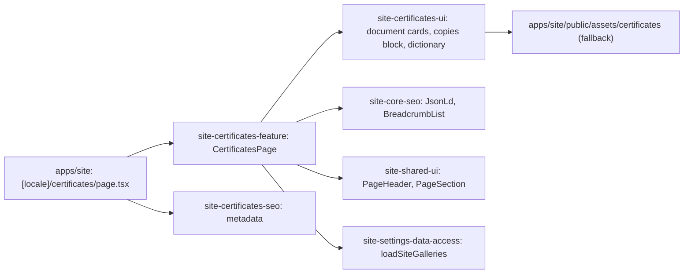

# Site: «Сертифікати» page

**Status:** code exists, checked 2026-11-11. Specification: [«Сертифікати» page](../../specs/site/certificates/001-certificates/README.md).

`/uk/certificates` and `/ru/certificates` show the eight documents on Brevi workwear: type examination certificates, declarations of conformity, annexes with the fabric lists, and sanitary conclusions, each for clothing against general industrial dirt and against low temperatures. A card shows the scan, the document name, the clothing it covers, and its standards; the scan opens in a new tab. A closing block says certified copies come with the shipment and links to «Контакти». The documents come from «Контент → Сертифікати» through `loadSiteGalleries` (`/api/public/galleries`, kept five minutes), with the texts in the page language (an empty Russian text shows the Ukrainian one). While the Admin list is empty or the API is unavailable the page shows its own documents, with text and scans from the live `brevi.com.ua` page.

## Structure diagram



## Code structure

```text
apps/site/src/app/[locale]/certificates/page.tsx     # route
apps/site/public/assets/certificates/                # scans, thumbnails, conformity mark
libs/site/
├── certificates/feature/src/lib/certificates-page.tsx  # block order, links, JSON-LD
├── certificates/ui/src/lib/
│   ├── data/certificate-documents.ts                # own documents, standards, file paths
│   ├── data/certificate-cards.ts                    # the card shape, own documents as cards
│   ├── i18n/certificates-dictionary.ts              # uk and ru text
│   └── sections/                                    # certificates-documents, certificates-copies
└── certificates/seo/src/lib/certificates-metadata.ts
```

To add or change a document: «Контент → Сертифікати» in the Admin.

## Tests

- `libs/site/certificates/ui/src/lib/certificates-ui.spec.tsx`
- `libs/site/certificates/feature/src/lib/certificates-page.spec.tsx`
- `libs/site/certificates/seo/src/lib/certificates-seo.spec.ts`

Run one project: `npx nx test site-certificates-ui`. All site libraries: `npm run test:site`.
