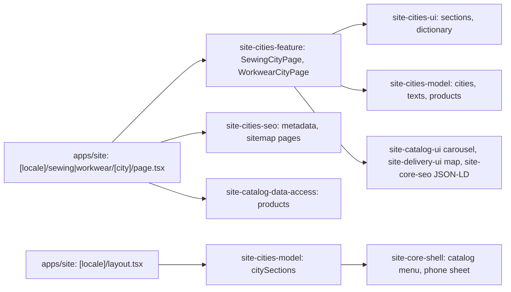

# Site: city pages «Пошиття» and «Робочий одяг»

**Status:** code exists, checked 2026-11-20. Specification: [city pages](../../specs/site/regions/002-city-pages/README.md).

Each of the 13 cities of the old site has two pages in both languages, 52 addresses in all:

- `/uk/sewing/{city}` («Пошиття»): sewing to a company's order. Intro, what we sew for the city's work, logo methods, own sewing models, the steps of an order, the delivery map, questions, links, call to order.
- `/uk/workwear/{city}` («Робочий одяг»): ready workwear and protective equipment from the catalog. Intro, what the city buys for work, models with protective equipment, prices by quantity, the delivery map, questions, links, call to order.

The intro, the three needs, the three questions, the title and the description are written for each city and kind of page (`libs/site/cities/model/src/lib/texts/`); a unit test fails when a sentence repeats on another page, when a page has fewer than 150 words of its own, when a title or description is too long or does not name the city, and on any other phone or online-order wording. The shared blocks are in the page dictionary. The Poltava pages show free pickup and the 250 грн courier instead of the delivery time.

The catalog menu and the phone «Каталог» sheet end with the sections «Пошиття» and «Робочий одяг», each listing the 13 cities; «Усі міста» leads to «Регіони», which links every city to both pages. Each page links to the same kind of page in three nearby cities, to its pair in the same city, and to «Регіони». «Купити» and «Залишити заявку» open the request window; the only phone is the site phone.

The pages are built ahead for the 13 cities; another slug follows «Контент → Переадресації» or answers 404. The models carousel reads the cached catalog products («Пошиття»: own sewing; «Робочий одяг»: own sewing and protective equipment in turn) and is left out while there are none. Each page has its own canonical, `hreflang`, a sitemap entry, `BreadcrumbList` (Головна › Регіони › page) and `FAQPage` of the visible questions.

The 26 old addresses of `brevi.com.ua` are listed with their new pages in the [redirect list](city-pages-redirects.md), for staff to add in «Контент → Переадресації».

## Structure diagram



## Code structure

```text
apps/site/src/app/[locale]/
├── sewing/[city]/page.tsx                    # «Пошиття» route: static params, metadata, 404 or redirect
└── workwear/[city]/page.tsx                  # «Робочий одяг» route
libs/site/cities/
├── model/src/lib/
│   ├── cities/                               # city list, menu sections, texts registry, carousel picker, sentence check
│   └── texts/{centre,east,south,south-east}/ # one file per city: both kinds, both languages
├── ui/src/lib/
│   ├── i18n/                                 # shared block text (uk, ru)
│   └── sections/                             # hero, points, faq, links, order
├── seo/src/lib/city-metadata.ts              # metadata and sitemap pages
└── feature/src/lib/                          # page data, products block, shared end, the two templates
```

## Tests

- `libs/site/cities/model/src/lib/cities/{city-list,city-texts,city-products}.spec.ts`
- `libs/site/cities/ui/src/lib/city-ui.spec.tsx`
- `libs/site/cities/seo/src/lib/city-metadata.spec.ts`
- `libs/site/cities/feature/src/lib/city-pages.spec.tsx`
- Menu: `libs/site/core/shell/src/lib/shell/site-shell.spec.tsx`; «Регіони» links: `libs/site/regions/{ui,feature}`.

Run one project: `npx nx test site-cities-model`. All site libraries: `npm run test:site`.
