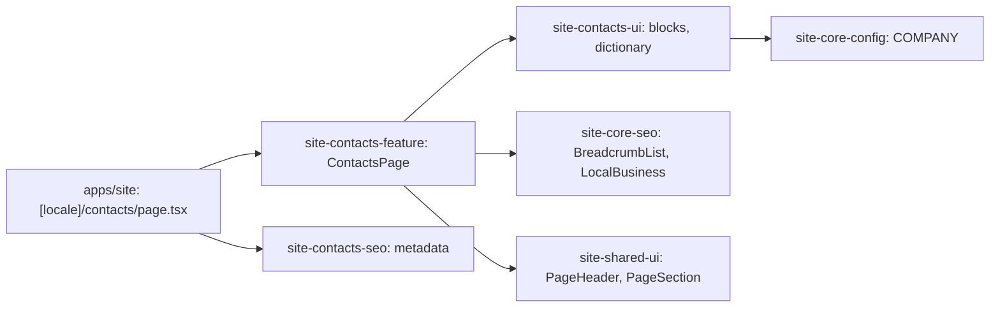

# Site: «Контакти» page

**Status:** code exists, checked 2026-11-10. Specification: [«Контакти» page](../../specs/site/contacts/001-contacts/README.md).

`/uk/contacts` and `/ru/contacts` show the company contacts (phone, email, address with the service area, working hours), a lazy Google map of the workshop with a link to Maps, and the two client managers with photo, phones, and email. The facts are from the live `brevi.com.ua` page and live in `COMPANY` (`phones`, `email`, `address`, `openingHours`, `managers`, `mapQuery`); the dictionary holds only captions. The page is static and reads no API.

The QR codes of the social networks of the live page are not shown: the profile addresses are not known yet (`COMPANY.socials` has `url: null`).

## Structure diagram



## Code structure

```text
apps/site/
├── public/assets/contacts/*.webp               # manager photos from the live page
└── src/app/[locale]/contacts/page.tsx          # route
libs/site/
├── contacts/feature/src/lib/contacts-page.tsx  # block order, JSON-LD
├── contacts/ui/src/lib/
│   ├── i18n/contacts-dictionary.ts             # uk and ru captions
│   └── sections/                               # contacts-info, -map, -managers
├── contacts/seo/src/lib/contacts-metadata.ts
├── shared/ui/src/lib/page-header.tsx           # breadcrumbs, label, h1, lead
└── core/config/src/lib/company.ts              # managers, mapQuery
```

## Tests

- `libs/site/contacts/ui/src/lib/contacts-ui.spec.tsx`
- `libs/site/contacts/feature/src/lib/contacts-page.spec.tsx`
- `libs/site/contacts/seo/src/lib/contacts-seo.spec.ts`
- `libs/site/shared/ui/src/lib/page-header.spec.tsx`

Run one project: `npx nx test site-contacts-ui`. All site libraries: `npm run test:site`.
