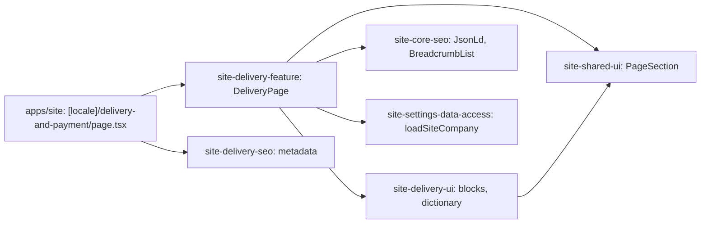

# Site: «Доставка та оплата» page

**Status:** code exists, checked 2026-11-10. Specification: [«Доставка та оплата» page](../../specs/site/delivery/001-delivery/README.md).

`/uk/delivery-and-payment` and `/ru/delivery-and-payment` show how Brevi ships and how to pay: four delivery ways with their cost, the footnote about what the cost depends on, payment rules, bank details, and the phone. The text and numbers are from the live `brevi.com.ua` page; Russian is its translation. The page is static and reads no API.

Bank details (`recipient`, `edrpou`, `iban`, `bank`) come from «Контакти та компанія» (`loadSiteCompany`). The sentence of the live page about paying by card on the site is left out: the new site has no online payment.

## Structure diagram



## Code structure

```text
apps/site/src/app/[locale]/delivery-and-payment/page.tsx  # route
libs/site/
├── delivery/feature/src/lib/delivery-page.tsx   # block order, links, JSON-LD
├── delivery/ui/src/lib/
│   ├── i18n/delivery-dictionary.ts              # uk and ru text
│   └── sections/                                # delivery-options, -payment, -contact
├── delivery/seo/src/lib/delivery-metadata.ts
└── core/config/src/lib/company.ts               # bankDetails
```

## Tests

- `libs/site/delivery/ui/src/lib/delivery-ui.spec.tsx`
- `libs/site/delivery/feature/src/lib/delivery-page.spec.tsx`
- `libs/site/delivery/seo/src/lib/delivery-seo.spec.ts`

Run one project: `npx nx test site-delivery-ui`. All site libraries: `npm run test:site`.
