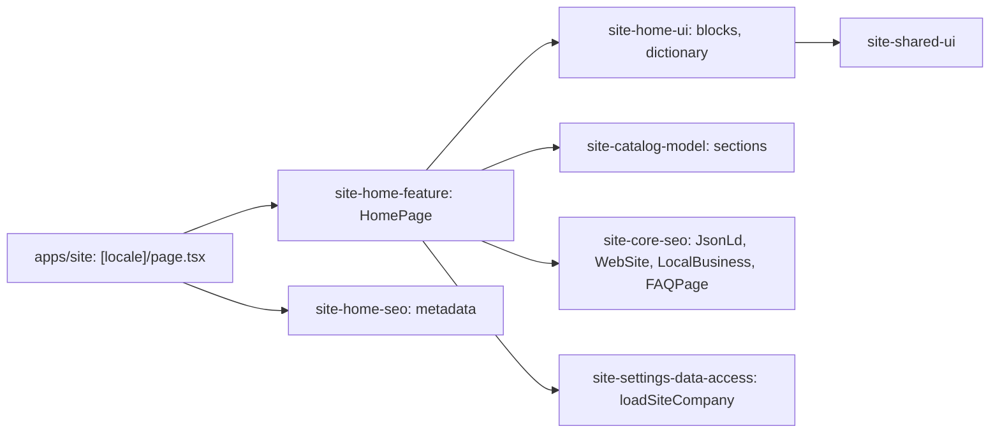

# Site: home page

**Status:** code exists, checked 2026-11-10. Specification: [home page](../../specs/site/home/001-home/README.md).

`/uk` and `/ru` show the home page of the «Строчка» mockup: first screen (offer, three facts, «Залишити заявку», sales phone, suit photo with four callouts), catalog sections, logo on the uniform, four work steps, own production, industries, contacts, SEO text with FAQ. Text is in the home dictionary (the SEO text and FAQ saved in «Сторінки сайту» replace it) and company facts in «Контакти та компанія» (`loadSiteCompany`); the catalog sections come from the [catalog](catalog.md) API through the route, and the block is left out while the catalog is empty.

It shows no prices and has no form (owner decision 2026-11-10): the price calculator and product cards come with the catalog step, the request form with the request step. «Залишити заявку» scrolls to the contacts block.

## Structure diagram



## Code structure

```text
apps/site/
├── public/assets/home/          # suit photos (front, back)
└── src/app/[locale]/page.tsx    # route
libs/site/
├── home/feature/src/lib/home-page.tsx   # block order, links, JSON-LD
├── home/ui/src/lib/
│   ├── i18n/home-dictionary.ts  # uk and ru text
│   └── sections/                # home-hero, home-catalog, home-logo, home-process,
│                                # home-production, home-industries, home-contacts, home-seo-text
├── home/seo/src/lib/            # home-metadata
├── catalog/model/src/lib/catalog-sections.ts
├── shared/ui/src/lib/page-section.tsx   # block frame: stitch label, h2, action link
└── core/i18n/src/lib/site-paths.ts
```

## Tests

- `libs/site/home/ui/src/lib/home-ui.spec.tsx`
- `libs/site/home/feature/src/lib/home-page.spec.tsx`
- `libs/site/home/seo/src/lib/home-seo.spec.ts`
- `libs/site/catalog/model/src/lib/catalog-sections.spec.ts`

Run one project: `npx nx test site-home-ui`. All site libraries: `npm run test:site`.
