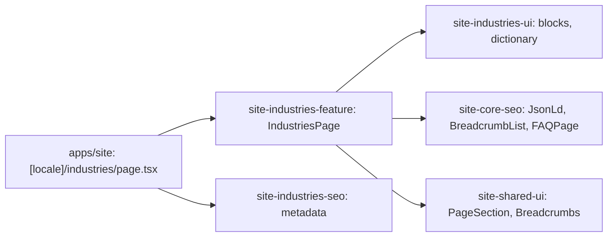

# Site: «Галузі» page

**Status:** code exists, checked 2026-11-10. Specification: [«Галузі» page](../../specs/site/industries/001-industries-hub/README.md).

`/uk/industries` and `/ru/industries` are the industries hub: the lead with the terms for enterprises (from 5 pieces, models and fabric for the task, logo and VAT), eight industries with typical garments, three steps to a quote, four frequent questions, and the call to order with «Залишити заявку» and the phone. The text is the live `brevi.com.ua` page «Спецодяг для підприємств» in both languages; the industries list repeats the home page. Industry landing pages (`/industries/{slug}`) do not exist yet, so the industries are not links. Company facts come from «Контакти та компанія»; the questions saved in «Сторінки сайту» replace the dictionary ones and its main text goes under them (BreviERP CNT-010).

## Structure diagram



## Code structure

```text
apps/site/src/app/[locale]/industries/page.tsx  # route
libs/site/
├── industries/feature/src/lib/industries-page.tsx  # block order, links, JSON-LD
├── industries/ui/src/lib/
│   ├── i18n/industries-dictionary.ts               # uk and ru text
│   └── sections/                                   # hero, list, steps, faq, order
└── industries/seo/src/lib/industries-metadata.ts
```

## Tests

- `libs/site/industries/ui/src/lib/industries-ui.spec.tsx`
- `libs/site/industries/feature/src/lib/industries-page.spec.tsx`
- `libs/site/industries/seo/src/lib/industries-seo.spec.ts`

Run one project: `npx nx test site-industries-ui`. All site libraries: `npm run test:site`.
