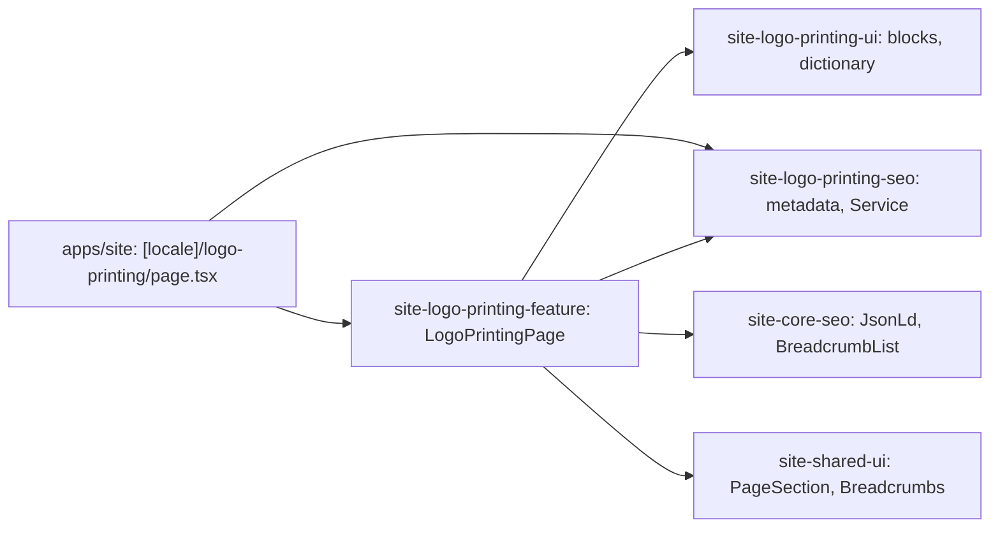

# Site: «Пошиття з логотипом» page

**Status:** code exists, checked 2026-11-10. Specification: [«Пошиття з логотипом» page](../../specs/site/logo-printing/001-logo-printing/README.md).

`/uk/logo-printing` and `/ru/logo-printing` describe logo branding of workwear: the lead with the order terms (from 5 pieces, 2–4 weeks, delivery across Ukraine), the three methods (embroidery, heat transfer, screen printing) with their advantages, the kinds of workwear Brevi brands, custom sewing with a logo, and the four order steps with «Залишити заявку» and the phone. The text is the live `brevi.com.ua` page «Нанесення логотипу на спецодяг (брендування спецодягу)» in both languages. The page is static and reads no API.

## Structure diagram



## Code structure

```text
apps/site/src/app/[locale]/logo-printing/page.tsx  # route
libs/site/
├── logo-printing/feature/src/lib/logo-printing-page.tsx  # block order, links, JSON-LD
├── logo-printing/ui/src/lib/
│   ├── i18n/logo-printing-dictionary.ts                  # uk and ru text
│   └── sections/                                         # hero, methods, garments, sewing, order
└── logo-printing/seo/src/lib/
    ├── logo-printing-metadata.ts
    └── logo-printing-json-ld.ts                          # Service
```

## Tests

- `libs/site/logo-printing/ui/src/lib/logo-printing-ui.spec.tsx`
- `libs/site/logo-printing/feature/src/lib/logo-printing-page.spec.tsx`
- `libs/site/logo-printing/seo/src/lib/logo-printing-seo.spec.ts`

Run one project: `npx nx test site-logo-printing-ui`. All site libraries: `npm run test:site`.
