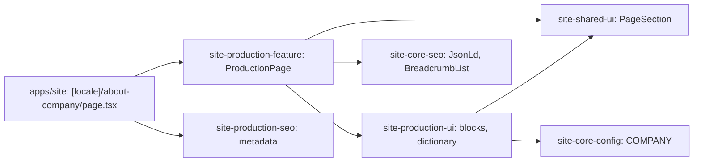

# Site: «Виробництво» page

**Status:** code exists, checked 2026-11-10. Specification: [«Виробництво» page](../../specs/site/production/001-production/README.md).

`/uk/about-company` and `/ru/about-company` show the page about Brevi's own sewing production: breadcrumbs, `h1` with two lead paragraphs and a suit photo, three production stages, fabric choice, threads and hardware, branding, and how to start an order. The text is the live `brevi.com.ua` page «Власне виробництво спецодягу Brevi»; Russian is its translation. The page is static and reads no API.

«Обговорити пошиття спецодягу» leads to the contacts block of the home page (`/uk#zayavka`) until the request page exists. The links to `/our-work`, `/logo-printing`, and `/contacts` answer 404 until their stages.

## Structure diagram



## Code structure

```text
apps/site/src/app/[locale]/about-company/page.tsx   # route
libs/site/
├── production/feature/src/lib/production-page.tsx  # block order, links, JSON-LD
├── production/ui/src/lib/
│   ├── i18n/production-dictionary.ts               # uk and ru text
│   └── sections/                                   # production-hero, -stages, -details, -order, -prose
├── production/seo/src/lib/production-metadata.ts
├── shared/ui/src/lib/                              # page-section, breadcrumbs
└── core/seo/src/lib/json-ld/breadcrumb-json-ld.ts
```

## Tests

- `libs/site/production/ui/src/lib/production-ui.spec.tsx`
- `libs/site/production/feature/src/lib/production-page.spec.tsx`
- `libs/site/production/seo/src/lib/production-seo.spec.ts`
- `libs/site/shared/ui/src/lib/breadcrumbs.spec.tsx`, `page-section.spec.tsx`

Run one project: `npx nx test site-production-ui`. All site libraries: `npm run test:site`.
