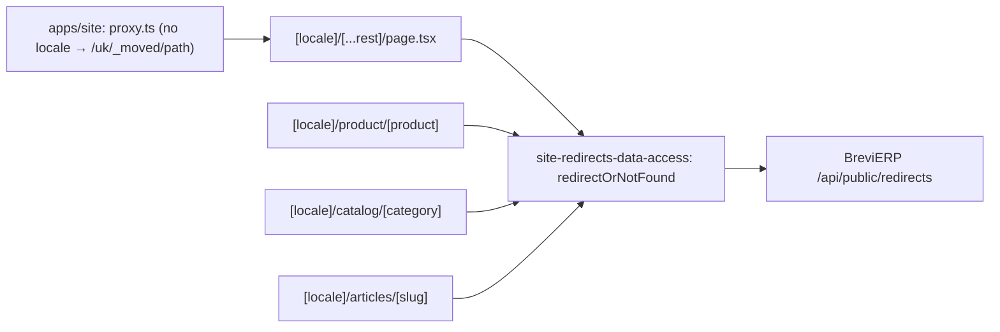

# Site: redirects of old addresses

**Status:** code exists, checked 2026-11-11. Backend: BreviERP CNT-005; Admin: [«Контент → Переадресації»](../admin/content.md).

An address the site does not have is looked up in the redirects staff keep in «Контент → Переадресації» before the 404 page is shown. A known address gets a permanent redirect (308, which search engines treat like 301) to its new page; the rest get the framed 404. This covers old-site addresses without a locale (`/specodyag-litnij`, `/zahyst-ruk/rukavychky-x`), old `/ru/...` addresses, and product, category and article pages whose address staff changed (`/uk/product/old-slug`). Only targets under `/uk` or `/ru` are followed. The list comes from the BreviERP public API `/api/public/redirects`, which already follows chains to the final page, and is kept five minutes (a failed read one minute); an unavailable API gives plain 404s.

## Structure diagram



## Code structure

```text
apps/site/src/proxy.ts, proxy-paths.ts                  # paths without a locale go to [...rest] under /uk/_moved/
apps/site/src/app/[locale]/[...rest]/page.tsx           # unknown path: redirect or framed 404
apps/site/src/app/[locale]/{product,catalog,articles}/  # a missing slug: redirect or 404
libs/site/redirects/data-access/src/lib/
  redirect-or-not-found.ts                              # permanentRedirect or notFound
  redirects-loader.ts                                   # cached list, tag `redirects`, shape check
  redirect-path.ts                                      # address as the Admin keeps it, lookup inside the site
```

## Tests

`npx nx test site-redirects-data-access` (`redirect-path.spec.ts`).
