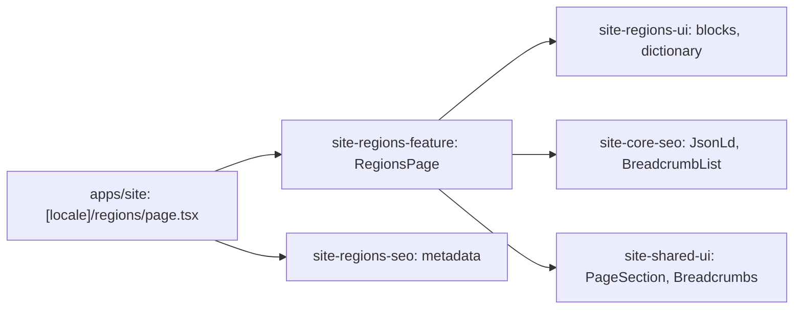

# Site: «Регіони» page

**Status:** code exists, checked 2026-11-10. Specification: [«Регіони» page](../../specs/site/regions/001-regions/README.md).

`/uk/regions` and `/ru/regions` are one page about orders from any city of Ukraine: the lead with the delivery terms (all Ukraine, shipped within 3 working days, Nova Poshta and SAT), four steps of an order from another city, the cities Brevi ships to as text, what a buyer in Poltava gets (pickup, courier, address), and the call to order. There is no page per city: the 26 city pages of the live site are near copies of one template. The footer links here with «Доставка по всій Україні», and `Organization` names Ukraine as the area served. The page is static and reads no API.

## Structure diagram



## Code structure

```text
apps/site/src/app/[locale]/regions/page.tsx  # route
libs/site/
├── regions/feature/src/lib/regions-page.tsx  # block order, links, JSON-LD
├── regions/ui/src/lib/
│   ├── i18n/regions-dictionary.ts            # uk and ru text
│   └── sections/                             # hero, steps, cities, local, order
└── regions/seo/src/lib/regions-metadata.ts
```

## Tests

- `libs/site/regions/ui/src/lib/regions-ui.spec.tsx`
- `libs/site/regions/feature/src/lib/regions-page.spec.tsx`
- `libs/site/regions/seo/src/lib/regions-seo.spec.ts`

Run one project: `npx nx test site-regions-ui`. All site libraries: `npm run test:site`.
