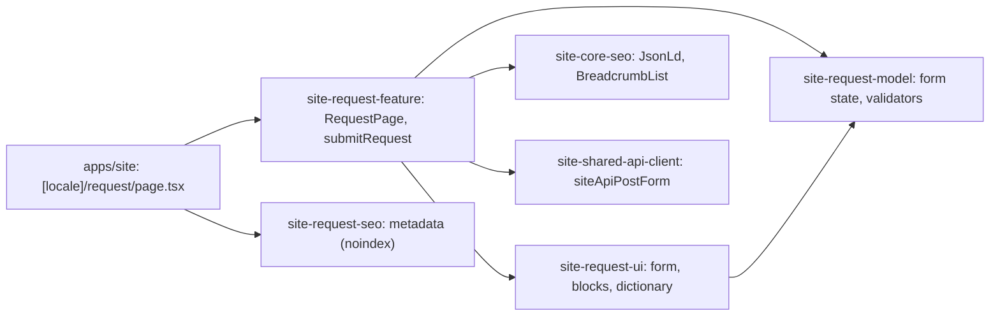

# Site: «Заявка» page

**Status:** page and form exist, checked 2026-11-10; requests go to BreviERP since 2026-11-11 (LEAD-002). Specification: [«Заявка» page](../../specs/site/request/001-request/README.md).

`/uk/request` and `/ru/request` are the request page every «Залишити заявку» button leads to. The visitor leaves a phone number and a manager calls back within 15 minutes. The form repeats the request form of the live `brevi.com.ua` page «Спецодяг для підприємств»: the phone is the only required field; what to sew, the approximate quantity, a comment, and a file with a brief or a layout (up to 10 MB) are optional. Next to the form are three steps of getting a quote and the site phone. The page is `noindex` and is not in the sitemap.

The form posts to the Server Action `submitRequest` (the page binds the locale), which cleans and checks the fields and the file and posts them with `siteApiPostForm` to `POST /api/public/site-requests`. BreviERP saves the request for «Менеджер сервісу › Заявки з сайту», puts the file on the CDN and lets the bot post it to the Telegram groups ticked on «Нагадування». A 200 shows `RequestSent`; any failure (a refused request, 429, a timeout) gets «Не вдалося надіслати запит» with the phone, so no visitor is told a manager received something that went nowhere. A hidden field `website` traps bots: when it is filled the visitor sees the thanks and nothing is posted.

## Structure diagram



## Code structure

```text
apps/site/src/app/[locale]/request/page.tsx  # route
apps/site/next.config.mjs                     # Server Action body limit for the file
libs/site/
├── request/model/src/lib/
│   ├── request-form.ts                      # fields, form state, limits, file formats
│   └── validators/request-validators.ts     # phone, field lengths, file
├── request/feature/src/lib/
│   ├── request-page.tsx                     # layout, links, JSON-LD
│   └── submit-request.ts                    # Server Action; posts to /api/public/site-requests
├── request/ui/src/lib/
│   ├── i18n/request-dictionary.ts           # uk and ru text
│   └── sections/                            # intro, form (client), sent, facts
└── request/seo/src/lib/request-metadata.ts
```

## Tests

- `libs/site/request/model/src/lib/validators/request-validators.spec.ts`
- `libs/site/request/ui/src/lib/request-ui.spec.tsx`
- `libs/site/request/feature/src/lib/request-page.spec.tsx`
- `libs/site/request/feature/src/lib/submit-request.spec.ts`
- `libs/site/request/seo/src/lib/request-metadata.spec.ts`

Run one project: `npx nx test site-request-ui`. All site libraries: `npm run test:site`.
