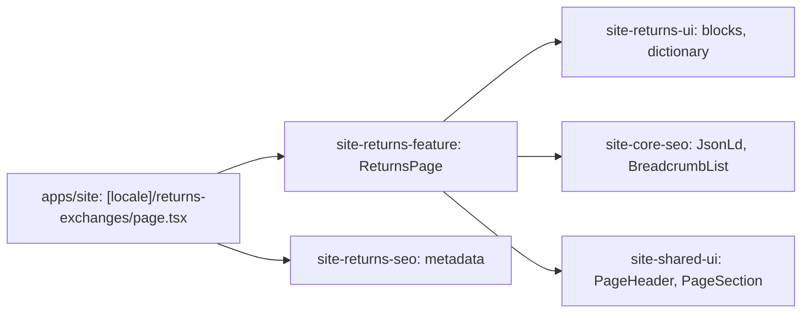

# Site: «Повернення та обмін» page

**Status:** code exists, checked 2026-11-10. Specification: [«Повернення та обмін» page](../../specs/site/returns/001-returns/README.md).

`/uk/returns-exchanges` and `/ru/returns-exchanges` show the return and exchange policy: general rules (14 days, conditions, exceptions) with a link to the consumer protection law, the conditions for three cases (basic requirements, a defect or mistake by Brevi, a return started by the client), and the exchange instruction in three numbered steps. The text is the live `brevi.com.ua` page; Russian is its translation. The page is static and reads no API.

## Structure diagram



## Code structure

```text
apps/site/src/app/[locale]/returns-exchanges/page.tsx  # route
libs/site/
├── returns/feature/src/lib/returns-page.tsx   # block order, links, JSON-LD
├── returns/ui/src/lib/
│   ├── i18n/returns-dictionary.ts             # uk and ru text as groups of items
│   └── sections/                              # returns-groups, returns-general
└── returns/seo/src/lib/returns-metadata.ts
```

## Tests

- `libs/site/returns/ui/src/lib/returns-ui.spec.tsx`
- `libs/site/returns/feature/src/lib/returns-page.spec.tsx`
- `libs/site/returns/seo/src/lib/returns-seo.spec.ts`

Run one project: `npx nx test site-returns-ui`. All site libraries: `npm run test:site`.
