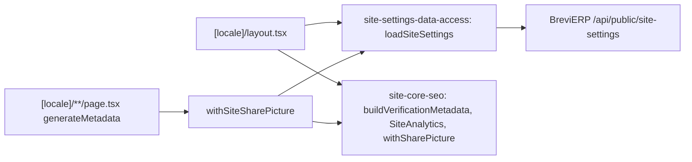

# Site: SEO settings (analytics, verification, sharing picture)

**Status:** code exists, checked 2026-11-11. Backend: BreviERP CNT-006; Admin: [«Контент → Налаштування SEO сайту»](../admin/content.md).

The site reads the settings of «Налаштування SEO сайту» from the BreviERP public API `/api/public/site-settings` and keeps them five minutes (a failed read one minute, with empty settings, so the site works without them):

- the root layout adds the `google-site-verification` and `msvalidate.01` (Bing) meta tags and renders Google Analytics 4 and Google Tag Manager with `next/script` after the page becomes interactive; an empty id or one of another shape renders nothing;
- every page's `generateMetadata` passes its metadata through `withSiteSharePicture`, which adds the sharing picture to Open Graph when the page has no picture of its own (a page's `openGraph` replaces the layout's whole, so the layout alone cannot give it).

The same stage also lists `x-default` (the Ukrainian version) in the sitemap alternates, uses the small copy of a product photo in the photo row of the product page, and adds `dateModified` to the article JSON-LD.

## Structure diagram



## Code structure

```text
apps/site/src/app/[locale]/layout.tsx                   # verification tags, analytics scripts, sharing picture for the root
apps/site/src/app/[locale]/**/page.tsx                  # generateMetadata → withSiteSharePicture
libs/site/settings/data-access/src/lib/
  site-settings-loader.ts                               # cached settings, tag `site-settings`, shape check
  share-picture-metadata.ts                             # withSiteSharePicture for page metadata
libs/site/core/seo/src/lib/
  metadata/site-codes.ts                                # id checks, verification metadata, withSharePicture
  analytics/site-analytics.tsx                          # GA4 and GTM scripts
```

## Tests

`npx nx test site-settings-data-access` (`site-settings-loader.spec.ts`), `npx nx test site-core-seo` (`site-codes.spec.ts`, `crawling.spec.ts`).
