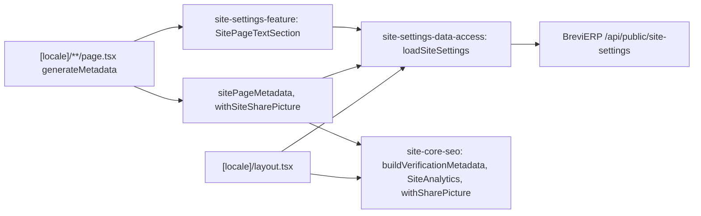

# Site: SEO settings (analytics, verification, sharing picture, page texts, company facts)

**Status:** code exists, checked 2026-11-11. Backend: BreviERP CNT-006, CNT-007, CNT-009 and CNT-010; Admin: [«Контент → Налаштування SEO сайту», «Сторінки сайту» and «Контакти та компанія»](../admin/content.md).

The site reads the settings of «Налаштування SEO сайту» from the BreviERP public API `/api/public/site-settings` and keeps them five minutes (a failed read one minute, with empty settings, so the site works without them):

- the root layout adds the `google-site-verification` and `msvalidate.01` (Bing) meta tags and renders Google Analytics 4 and Google Tag Manager with `next/script` after the page becomes interactive; an empty id or one of another shape renders nothing;
- the 16 fixed pages pass their metadata through `sitePageMetadata(key, locale, …)`: the title and description of «Сторінки сайту» (`/api/public/site-pages`, kept five minutes) replace the page's own, also in Open Graph, and an empty text keeps the page's own; then the sharing picture is added;
- the main text and frequent questions of «Сторінки сайту» (same answer, CNT-010) go at the bottom of the page: home and «Галузі» put them in place of their own SEO text and questions (the dictionary stays the fallback); the other fixed pages except «Заявка» render `SitePageTextSection` of `site-settings-feature` after the page, which shows the text, the questions as `<details>` and their `FAQPage`, and nothing while staff wrote neither;
- product, category and article pages pass their metadata through `withSiteSharePicture`, which adds the sharing picture to Open Graph when the page has no picture of its own (a page's `openGraph` replaces the layout's whole, so the layout alone cannot give it).

The company facts of «Контакти та компанія» (phone, email, address, hours, managers, payment details, profile links) come from `/api/public/company` through `loadSiteCompany`, kept five minutes (a failed read one minute, with `COMPANY` of `site-core-config` as the fallback). The layout passes them to the shell and the Organization JSON-LD; every page that shows the phone, the address or the payment details reads them in its feature component and passes `company` to its blocks. The name and the logo always stay the site's own.

The same stage also lists `x-default` (the Ukrainian version) in the sitemap alternates, uses the small copy of a product photo in the photo row of the product page, and adds `dateModified` to the article JSON-LD.

## Structure diagram



## Code structure

```text
apps/site/src/app/[locale]/layout.tsx                   # verification tags, analytics scripts, sharing picture for the root
apps/site/src/app/[locale]/**/page.tsx                  # generateMetadata → withSiteSharePicture
libs/site/settings/data-access/src/lib/
  site-settings-loader.ts                               # cached settings, tag `site-settings`, shape check
  site-pages-loader.ts                                  # cached page texts, tag `site-pages`, shape check
  page-text-metadata.ts                                 # withPageText: saved texts over the page's own
  site-metadata.ts                                      # sitePageMetadata, withSiteSharePicture
libs/site/settings/feature/src/lib/
  site-page-text-section.tsx                            # SitePageTextSection: saved main text, questions, FAQPage
libs/site/shared/ui/src/lib/faq-list.tsx                # FaqList: questions as <details>, also used by home and «Галузі»
libs/site/core/seo/src/lib/
  metadata/site-codes.ts                                # id checks, verification metadata, withSharePicture
  analytics/site-analytics.tsx                          # GA4 and GTM scripts
```

## Tests

`npx nx test site-settings-data-access` (`site-settings-loader.spec.ts`, `site-pages-loader.spec.ts`), `npx nx test site-settings-feature` (`site-page-text-section.spec.tsx`), `npx nx test site-core-seo` (`site-codes.spec.ts`, `crawling.spec.ts`).
