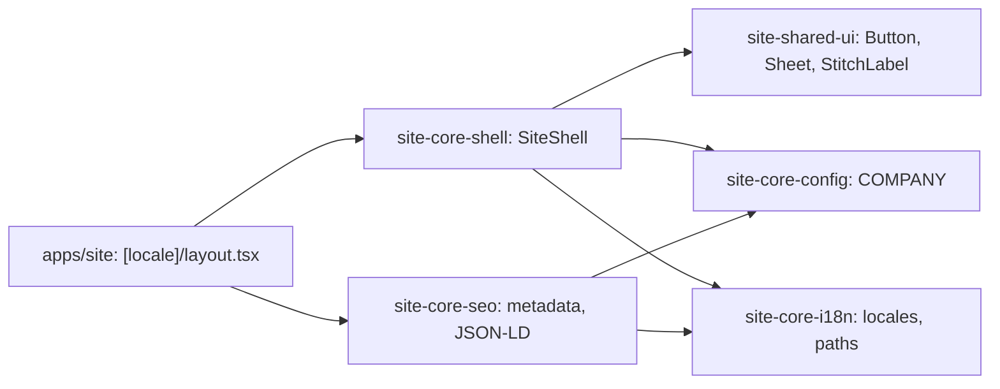

# Site: shell (layout, header, footer)

**Status:** code exists, checked 2026-11-20 (client corrections: no short terms, «Доставка та оплата» in the menu, phone header without the bottom bar). Specifications: [site shell](../../specs/site/shell/001-site-shell/README.md), [header, menu, and footer redesign](../../specs/site/shell/002-header-footer-redesign/README.md).

Every page under `/uk` and `/ru` is rendered inside `SiteShell`: a skip link, the header (two rows on wide screens, one row on phones), `<main id="content">`, the dark footer, and the request window slot (`@modal`, see [request](request.md)).

- **Header.** Contacts row: logo with the brand line («Спецодяг і засоби захисту», «власне виробництво, Полтава»), the one company phone with hours and e-mail, «Залишити заявку» (opens the request window). Menu row: the «Каталог» button, the site menu («Пошиття з логотипом», «Ціни для опту», «Доставка та оплата», «Про виробництво», «Наші роботи», «Контакти»; «Галузі» is in the footer only, owner 2026-11-20), the «Пошук» icon (opens the catalog search under the header, see [catalog](catalog.md)), the UA/RU toggle. Only the menu row stays on screen while scrolling, and then it also shows the phone.
- **Catalog menu.** Two panes: sections with icons (the same as on the catalog root) on the left, subsections of the chosen section on the right, the logo sewing card from 1280 px. After the catalog sections come «Пошиття» and «Робочий одяг» with the 13 cities, leading to the [city pages](city-pages.md); their «Усі міста» leads to «Регіони». The layout passes them as `citySections`, so the footer does not list them. No buttons under the subsections (owner 2026-11-20); only a catalog without its own sections shows «Весь каталог». The phone «Каталог» sheet has the same sections. The whole menu is in the HTML while closed.
- **Phones and tablets (below 1024 px).** One header row: on the left the logo with the brand line (the second line from 640 px); on the right, read from the right edge, «Меню», the yellow «Каталог» and the phone (an icon below 640 px, the number above). «Каталог» and «Меню» open side sheets, rendered only while open. «Меню» holds the catalog search, the site menu, «Залишити заявку», the UA/RU toggle and the contacts. There is no bottom bar (owner 2026-11-20).
- **Footer.** Call band with the phone and «Залишити заявку»; brand; catalog, buyer, and company links; contacts with the map link; social network names without links until the owner gives the addresses; legal name and ЄДРПОУ. Column titles are plain text, not headings.

Company facts come as a prop from the layout, which reads «Контакти та компанія» with `loadSiteCompany` ([SEO settings](seo-settings.md)); `COMPANY` is the fallback and always gives the name and the logo. The catalog sections come as a prop from the layout, which reads the [catalog](catalog.md) tree on the server; every entry opens its category page, and with an empty catalog only «Весь каталог» remains. There is no search field until the catalog page exists.

`/` redirects to `/uk`. Unknown paths under a locale get a 404 inside the frame; paths without a locale get a bare Ukrainian 404. Indexing is off unless `SITE_ENV=production` and `SITE_INDEXING=true`.

## Structure diagram



## Code structure

```text
apps/site/
├── next.config.mjs            # / -> /uk, global 404, workspace root
└── src/
    ├── proxy.ts              # 404 for paths without a locale
    └── app/
        ├── global.css        # «Строчка» tokens
        ├── fonts.ts          # Manrope, IBM Plex Mono
        ├── global-not-found.tsx
        ├── global-error.tsx     # 500 when the root layout itself fails
        ├── robots.ts, sitemap.ts, manifest.ts
        └── [locale]/
            ├── layout.tsx    # html, SiteShell, Organization JSON-LD
            ├── page.tsx      # home page, see the home card
            ├── not-found.tsx, error.tsx
            └── [...rest]/page.tsx # unknown path -> framed 404
```

```text
libs/site/
├── core/config/src/lib/
│   ├── site-config.ts        # SITE_URL, BREVI_API_URL, SITE_ENV, SITE_INDEXING
│   └── company.ts            # phones, address, email, hours, logo
├── core/i18n/src/lib/
│   ├── locales.ts            # uk, ru, language tags
│   └── localized-path.ts     # /uk/... builders, language switch path
├── core/seo/src/lib/
│   ├── metadata/             # root and page metadata, alternates, robots meta
│   ├── crawling/             # robots.txt and sitemap builders
│   └── json-ld/              # JsonLd, Organization, WebSite, LocalBusiness, BreadcrumbList, FAQPage
├── core/shell/src/lib/
│   ├── shell/site-shell.tsx  # page frame
│   ├── header/bar/           # site-header, header-search (wide screens), show-when-stuck, use-dismiss
│   ├── header/catalog-menu/  # catalog-menu with its sections, panel and promo panes, catalog-section-icon
│   ├── mobile/               # mobile-header-actions (phone, «Каталог», «Меню») with the catalog and menu sheets
│   ├── footer/               # site-footer, footer-call-band, footer-contacts
│   ├── controls/             # locale-switch, nav-link
│   ├── navigation/           # SHELL_PATHS (= SITE_PATHS of core/i18n), menu and footer links
│   ├── i18n/shell-dictionary.ts
│   └── not-found/, error/    # 404 and 500 views
└── shared/ui/src/lib/        # button, sheet, dialog, stitch-label, cn
```

## Tests

- `libs/site/core/shell/src/lib/shell/site-shell.spec.tsx`, `navigation/site-navigation.spec.ts`
- `libs/site/core/seo/src/lib/**/*.spec.ts(x)`
- `libs/site/core/i18n/src/lib/localized-path.spec.ts`, `libs/site/core/config/src/lib/site-config.spec.ts`
- `libs/site/shared/ui/src/lib/*.spec.tsx`

Run one project: `npx nx test site-core-shell`. All site libraries: `npm run test:site`.
