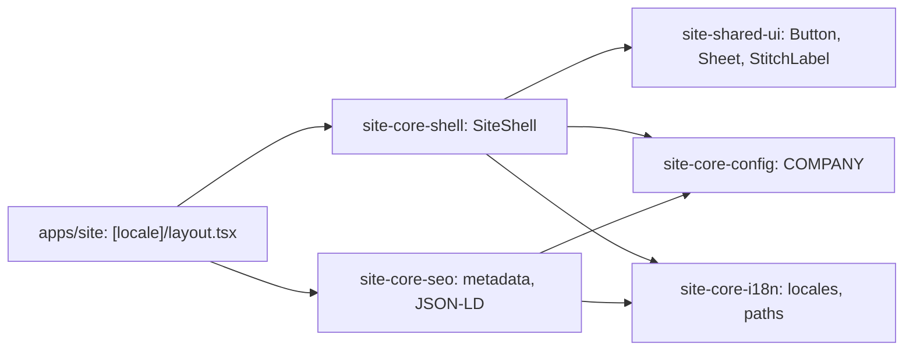

# Site: shell (layout, header, footer)

**Status:** code exists, checked 2026-11-10. Specification: [site shell](../../specs/site/shell/001-site-shell/README.md).

Every page under `/uk` and `/ru` is rendered inside `SiteShell`: a skip link, the top line (tagline, working hours, office phone, UA/RU), the sticky header (logo, menu with the catalog mega menu, «Заявка», sales phone), `<main id="content">`, and the footer (catalog sections, company and buyer pages, contacts, social network names without links until the owner gives the addresses). Below 1024 px the menu is a side sheet. The shell reads no API: company facts come from `COMPANY`, catalog sections from a fixed list taken from the Angular storefront.

`/` redirects to `/uk`. Unknown paths under a locale get a 404 inside the frame; paths without a locale get a bare two-language 404. Indexing is off unless `SITE_ENV=production` and `SITE_INDEXING=true`.

## Structure diagram



## Code structure

```text
apps/site/
├── next.config.ts            # / -> /uk, global 404, workspace root
└── src/
    ├── proxy.ts              # 404 for paths without a locale
    └── app/
        ├── global.css        # «Строчка» tokens
        ├── fonts.ts          # Manrope, IBM Plex Mono
        ├── global-not-found.tsx
        ├── robots.ts, sitemap.ts, manifest.ts
        └── [locale]/
            ├── layout.tsx    # html, SiteShell, Organization JSON-LD
            ├── page.tsx      # temporary first screen until the home step
            ├── not-found.tsx, error.tsx
            └── [...rest]/page.tsx # unknown path -> framed 404
```

```text
libs/site/
├── core/config/src/lib/
│   ├── site-config.ts        # SITE_URL, BREVI_API_URL, SITE_ENV, SITE_INDEXING
│   └── company.ts            # phones, address, email, hours, logo
├── core/i18n/src/lib/
│   ├── locales.ts            # uk, ru, language tags
│   └── localized-path.ts     # /uk/... builders, language switch path
├── core/seo/src/lib/
│   ├── metadata/             # root and page metadata, alternates, robots meta
│   ├── crawling/             # robots.txt and sitemap builders
│   └── json-ld/              # JsonLd, Organization, WebSite, LocalBusiness
├── core/shell/src/lib/
│   ├── site-shell.tsx        # page frame
│   ├── header/               # top-line, site-header, catalog-menu, header-actions, mobile-menu
│   ├── footer/site-footer.tsx
│   ├── controls/             # locale-switch, nav-link
│   ├── navigation/           # SHELL_PATHS, menu and footer links, catalog sections
│   ├── i18n/shell-dictionary.ts
│   └── not-found/, error/    # 404 and 500 views
└── shared/ui/src/lib/        # button, sheet, stitch-label, cn
```

## Tests

- `libs/site/core/shell/src/lib/site-shell.spec.tsx`, `navigation/site-navigation.spec.ts`
- `libs/site/core/seo/src/lib/**/*.spec.ts(x)`
- `libs/site/core/i18n/src/lib/localized-path.spec.ts`, `libs/site/core/config/src/lib/site-config.spec.ts`
- `libs/site/shared/ui/src/lib/*.spec.tsx`

Run one project: `npx nx test site-core-shell`. All site libraries: `npm run test:site`.
