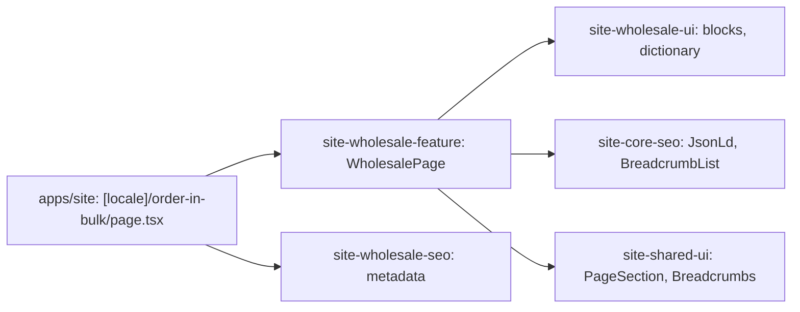

# Site: «Ціни для опту» page

**Status:** code exists, checked 2026-11-10. Specification: [«Ціни для опту» page](../../specs/site/wholesale/001-wholesale/README.md).

`/uk/order-in-bulk` and `/ru/order-in-bulk` describe wholesale orders: the lead with the terms (from 5 pieces, three price levels, VAT), the three price levels by quantity (1–9, 10–39, 40+) without prices, what can be ordered in bulk, why enterprises order from Brevi, and the four order steps with «Залишити заявку» and the phone. The text is the live `brevi.com.ua` page «Спецодяг оптом від виробника» in both languages; the price levels come from the client brief. The page is static and reads no API.

## Structure diagram



## Code structure

```text
apps/site/src/app/[locale]/order-in-bulk/page.tsx  # route
libs/site/
├── wholesale/feature/src/lib/wholesale-page.tsx  # block order, links, JSON-LD
├── wholesale/ui/src/lib/
│   ├── i18n/wholesale-dictionary.ts              # uk and ru text
│   └── sections/                                 # hero, tiers, range, reasons, order
└── wholesale/seo/src/lib/wholesale-metadata.ts
```

## Tests

- `libs/site/wholesale/ui/src/lib/wholesale-ui.spec.tsx`
- `libs/site/wholesale/feature/src/lib/wholesale-page.spec.tsx`
- `libs/site/wholesale/seo/src/lib/wholesale-seo.spec.ts`

Run one project: `npx nx test site-wholesale-ui`. All site libraries: `npm run test:site`.
