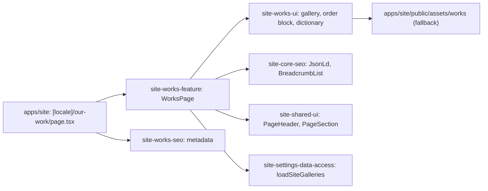

# Site: «Наші роботи» page

**Status:** code exists, checked 2026-11-11. Specification: [«Наші роботи» page](../../specs/site/works/001-works/README.md).

`/uk/our-work` and `/ru/our-work` show a gallery of photos of workwear that Brevi sewed for clients, and a call to order with links to the request form and to «Виробництво». The photos come from «Контент → Наші роботи» through `loadSiteGalleries` (`/api/public/galleries`, kept five minutes), each with its small copy for the grid, its large file that opens in a new tab, and the description staff wrote as the picture text. While the Admin list is empty or the API is unavailable the page shows its own files: the originals of the live `brevi.com.ua` gallery, converted to WebP in two sizes.

## Structure diagram



## Code structure

```text
apps/site/src/app/[locale]/our-work/page.tsx  # route
apps/site/public/assets/works/                # work-NNN.webp and work-NNN-thumb.webp
libs/site/
├── works/feature/src/lib/works-page.tsx      # block order, links, JSON-LD
├── works/ui/src/lib/
│   ├── data/work-photos.ts                   # own photo list with sizes, file paths, STATIC_WORK_PICTURES
│   ├── i18n/works-dictionary.ts              # uk and ru text
│   └── sections/                             # works-gallery, works-order
└── works/seo/src/lib/works-metadata.ts
```

To add a photo: «Контент → Наші роботи» in the Admin.

## Tests

- `libs/site/works/ui/src/lib/works-ui.spec.tsx`
- `libs/site/works/feature/src/lib/works-page.spec.tsx`
- `libs/site/works/seo/src/lib/works-seo.spec.ts`

Run one project: `npx nx test site-works-ui`. All site libraries: `npm run test:site`.
