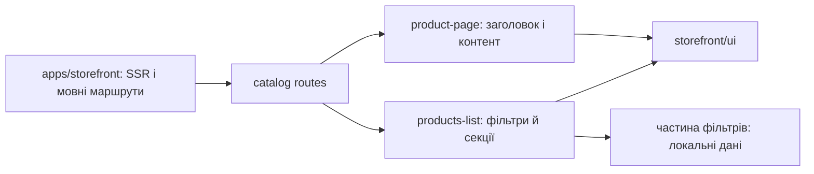

# Storefront: каталог і сторінка товару

**Стан:** маршрути й UI наявні, звірено 2026-10-16; інтерактивні фільтри списку частково працюють з локальними даними в компоненті, тому не слід видавати їх за інтеграцію з товарним API.

`/uk|ru/catalog` відкриває список із фільтрами, сортуванням і секцією товарів. `/uk|ru/product-page` відкриває сторінку товару, яка складається із заголовка та контенту. `catalog` тримає сторінки й секції разом; `storefront/ui` постачає повторно використовувані елементи на кшталт `PageHeader`, `storefront/util` — локалізовані посилання. `apps/storefront` відповідає за SSR, маршрути і провайдери.

## Схема будови



## Структура в коді

```text
libs/storefront/feature/catalog/
└── src/lib/
    ├── pages/
    │   ├── product-page/
    │   │   └── product.page.ts # сторінка товару
    │   └── products-list/
    │       └── products-list.page.ts # список
    ├── sections/
    │   ├── product-content/
    │   │   └── product-content.ts # контент товару
    │   ├── product-list/
    │   │   └── product-list.ts # секція списку
    │   └── product-tabs/
    │       └── product-tabs.ts # вкладки товару
    └── lib.routes.ts # маршрути
```

```text
libs/storefront/ui/
└── src/lib/page-header/
    └── page-header.ts # спільний заголовок
```

**Де шукати:** [маршрути](../../../libs/storefront/feature/catalog/src/lib/lib.routes.ts), [список](../../../libs/storefront/feature/catalog/src/lib/pages/products-list/products-list.page.ts), [сторінка товару](../../../libs/storefront/feature/catalog/src/lib/pages/product-page/product.page.ts), [секції товару](../../../libs/storefront/feature/catalog/src/lib/sections/product-content/product-content.ts), [поточна API-межа](../../architecture/api/storefront.md).
