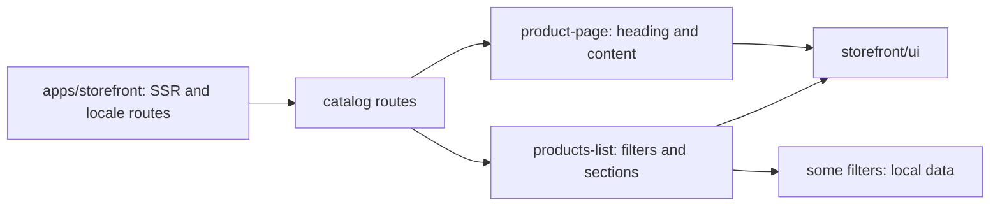

# Storefront: Catalog and Product Page

**Status:** routes and UI exist, checked 2026-10-16; interactive list filters
partially use local component data, so do not describe them as integration with
the product API.

`/uk|ru/catalog` opens a list with filters, sorting, and a product section.
`/uk|ru/product-page` opens a product page composed of a heading and content.
`catalog` keeps pages and sections together; `storefront/ui` provides reusable
elements such as `PageHeader`, and `storefront/util` provides localized links.
`apps/storefront` owns SSR, routes, and providers.

## Structure diagram



## Code structure

```text
libs/storefront/feature/catalog/
└── src/lib/
    ├── pages/
    │   ├── product-page/
    │   │   └── product.page.ts # product page
    │   └── products-list/
    │       └── products-list.page.ts # list
    ├── sections/
    │   ├── product-content/
    │   │   └── product-content.ts # product content
    │   ├── product-list/
    │   │   └── product-list.ts # list section
    │   └── product-tabs/
    │       └── product-tabs.ts # product tabs
    └── lib.routes.ts # routes
```

```text
libs/storefront/ui/
└── src/lib/page-header/
    └── page-header.ts # shared heading
```

**Where to look:** [routes](../../../libs/storefront/feature/catalog/src/lib/lib.routes.ts), [list](../../../libs/storefront/feature/catalog/src/lib/pages/products-list/products-list.page.ts), [product page](../../../libs/storefront/feature/catalog/src/lib/pages/product-page/product.page.ts), [product sections](../../../libs/storefront/feature/catalog/src/lib/sections/product-content/product-content.ts), [current API boundary](../../architecture/api/storefront.md).

## Tests

No automated tests cover this feature yet; Storefront projects have no `test` target.
