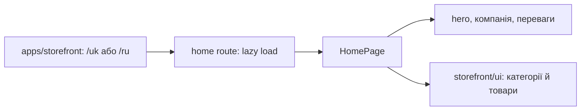

# Storefront: головна сторінка

**Стан:** наявний маршрут і компоненти, звірено 2026-10-16.

Під `/uk` і `/ru` порожній дочірній шлях відкриває `HomePage`. Сторінка складає власні секції hero, прев'ю компанії й переваги з повторно використовуваними `ProductCategories` та `InStockWorkwear` зі `storefront/ui`. Маршрут ліниво завантажує page component; локалізацію й спільну оболонку забезпечує застосунок.

## Схема будови



## Структура в коді

```text
apps/storefront/
└── src/app/
    └── app.routes.ts # загальні маршрути
```

```text
libs/storefront/feature/home/
└── src/lib/
    ├── page/
    │   └── home.page.ts # сторінка
    ├── sections/
    │   ├── about-preview/
    │   │   └── about-preview.ts # про компанію
    │   ├── company-highlights/
    │   │   └── company-highlights.ts # переваги
    │   └── main-hero/
    │       └── main-hero.ts # hero
    └── lib.routes.ts # маршрут feature
```

```text
libs/storefront/shell/
└── src/
    └── index.ts # спільна оболонка
```

```text
libs/storefront/ui/
└── src/lib/sections/product-categories/
    └── product-categories.ts # спільні категорії
```

**Де шукати:** [загальні маршрути](../../../apps/storefront/src/app/app.routes.ts), [маршрут feature](../../../libs/storefront/feature/home/src/lib/lib.routes.ts), [сторінка](../../../libs/storefront/feature/home/src/lib/page/home.page.ts), [спільна оболонка](../../../libs/storefront/shell/src/index.ts).
