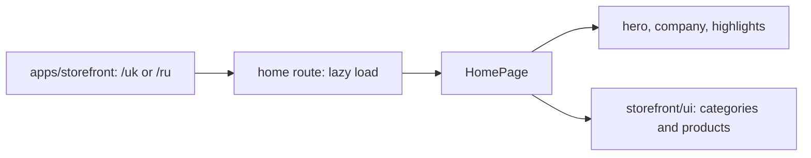

# Storefront: Home Page

**Status:** route and components exist, checked 2026-10-16.

Under `/uk` and `/ru`, the empty child path opens `HomePage`. The page composes
its own hero, company preview, and highlights sections with the reusable
`ProductCategories` and `InStockWorkwear` from `storefront/ui`. The route
lazy-loads the page component; the application provides localization and the
shared shell.

## Structure diagram



## Code structure

```text
apps/storefront/
└── src/app/
    └── app.routes.ts # shared routes
```

```text
libs/storefront/feature/home/
└── src/lib/
    ├── page/
    │   └── home.page.ts # page
    ├── sections/
    │   ├── about-preview/
    │   │   └── about-preview.ts # company preview
    │   ├── company-highlights/
    │   │   └── company-highlights.ts # highlights
    │   └── main-hero/
    │       └── main-hero.ts # hero
    └── lib.routes.ts # feature route
```

```text
libs/storefront/shell/
└── src/
    └── index.ts # shared shell
```

```text
libs/storefront/ui/
└── src/lib/sections/product-categories/
    └── product-categories.ts # shared categories
```

**Where to look:** [shared routes](../../../apps/storefront/src/app/app.routes.ts), [feature route](../../../libs/storefront/feature/home/src/lib/lib.routes.ts), [page](../../../libs/storefront/feature/home/src/lib/page/home.page.ts), [shared shell](../../../libs/storefront/shell/src/index.ts).

## Tests

No automated tests cover this feature yet; Storefront projects have no `test` target.
