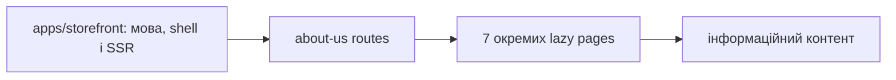

# Storefront: компанія та інформаційні сторінки

**Стан:** сім маршрутів і сторінок наявні, звірено 2026-10-16.

Бібліотека `about-us` містить окремі сторінки `/about-company`, `/delivery-and-payment`, `/articles`, `/agreement`, `/returns-exchanges`, `/our-work` і `/certificates` під мовними префіксами `/uk` та `/ru`. Кожна сторінка ліниво завантажується власним маршрутом; спільні локалізація, shell і SSR належать застосунку. Це група інформаційних сторінок, а не одна сторінка з усіма розділами.

## Схема будови



## Структура в коді

```text
libs/storefront/feature/about-us/
└── src/lib/
    ├── pages/
    │   ├── about-company/
    │   │   └── about-company.page.ts # приклад сторінки компанії
    │   ├── agreement/
    │   │   └── agreement.page.ts # угода
    │   ├── articles/
    │   │   └── articles.page.ts # статті
    │   ├── certificates/
    │   │   └── certificates.page.ts # сертифікати
    │   ├── delivery-and-payment/
    │   │   └── delivery-and-payment.page.ts # доставка
    │   ├── our-work/
    │   │   └── our-work.page.ts # роботи
    │   └── returns-exchanges/
    │       └── returns-exchanges.page.ts # повернення
    └── lib.routes.ts # маршрути і відповідність сторінок
```

```text
apps/storefront/
└── src/app/
    └── app.routes.ts # загальні маршрути
```

**Де шукати:** [маршрути і відповідність сторінок](../../../../libs/storefront/feature/about-us/src/lib/lib.routes.ts), [приклад сторінки компанії](../../../../libs/storefront/feature/about-us/src/lib/pages/about-company/about-company.page.ts), [загальні маршрути](../../../../apps/storefront/src/app/app.routes.ts), [runtime Storefront](../../../architecture/storefront/runtime.md).
