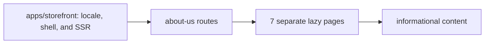

# Storefront: Company and Information Pages

**Status:** seven routes and pages exist, checked 2026-10-16.

The `about-us` library contains separate pages for `/about-company`,
`/delivery-and-payment`, `/articles`, `/agreement`, `/returns-exchanges`,
`/our-work`, and `/certificates` under the `/uk` and `/ru` language prefixes.
Each page is lazy-loaded through its own route; shared localization, shell,
and SSR belong to the application. This is a group of information pages, not
one page containing every section.

## Structure diagram



## Code structure

```text
libs/storefront/feature/about-us/
└── src/lib/
    ├── pages/
    │   ├── about-company/
    │   │   └── about-company.page.ts # company page example
    │   ├── agreement/
    │   │   └── agreement.page.ts # agreement
    │   ├── articles/
    │   │   └── articles.page.ts # articles
    │   ├── certificates/
    │   │   └── certificates.page.ts # certificates
    │   ├── delivery-and-payment/
    │   │   └── delivery-and-payment.page.ts # delivery
    │   ├── our-work/
    │   │   └── our-work.page.ts # work
    │   └── returns-exchanges/
    │       └── returns-exchanges.page.ts # returns
    └── lib.routes.ts # routes and page mapping
```

```text
apps/storefront/
└── src/app/
    └── app.routes.ts # shared routes
```

**Where to look:** [routes and page mapping](../../../../libs/storefront/feature/about-us/src/lib/lib.routes.ts), [company page example](../../../../libs/storefront/feature/about-us/src/lib/pages/about-company/about-company.page.ts), [shared routes](../../../../apps/storefront/src/app/app.routes.ts), [Storefront runtime](../../../architecture/storefront/runtime.md).

## Tests

No automated tests cover this feature yet; Storefront projects have no `test` target.
