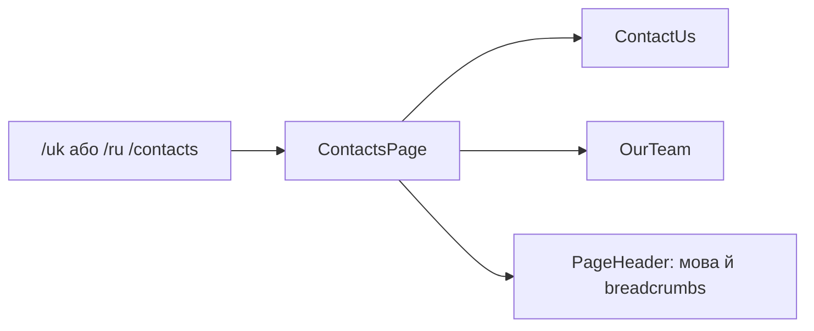

# Storefront: контакти

**Стан:** наявний маршрут і сторінка, звірено 2026-10-16.

`/uk|ru/contacts` ліниво відкриває `ContactsPage`. Сторінка складає `ContactUs` і `OurTeam`, а заголовок і breadcrumbs формує з активної мови через Transloco та `PageHeader` зі `storefront/ui`. Фактичні інтерактивні дії перевіряй у секціях, не припускаючи backend-форму лише з назви `ContactUs`.

## Схема будови



## Структура в коді

```text
libs/storefront/feature/contacts/
└── src/lib/
    ├── page/
    │   └── contacts.page.ts # сторінка
    ├── sections/
    │   ├── contact-us/
    │   │   └── contact-us.ts # контактна секція
    │   └── our-team/
    │       └── our-team.ts # секція команди
    └── lib.routes.ts # маршрут
```

```text
libs/storefront/ui/
└── src/lib/page-header/
    └── page-header.ts # спільний заголовок
```

**Де шукати:** [маршрут](../../../../libs/storefront/feature/contacts/src/lib/lib.routes.ts), [сторінка](../../../../libs/storefront/feature/contacts/src/lib/page/contacts.page.ts), [контактна секція](../../../../libs/storefront/feature/contacts/src/lib/sections/contact-us/contact-us.ts), [секція команди](../../../../libs/storefront/feature/contacts/src/lib/sections/our-team/our-team.ts).
