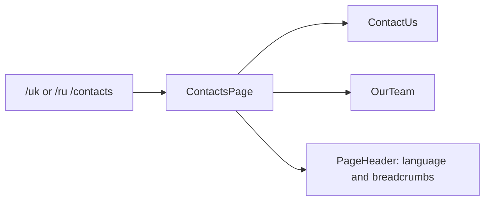

# Storefront: Contacts

**Status:** route and page exist, checked 2026-10-16.

`/uk|ru/contacts` lazily opens `ContactsPage`. The page composes `ContactUs`
and `OurTeam`, while the heading and breadcrumbs are built from the active
language through Transloco and `PageHeader` from `storefront/ui`. Check actual
interactive behavior in the sections; do not assume a backend form from the
name `ContactUs` alone.

## Structure diagram



## Code structure

```text
libs/storefront/feature/contacts/
└── src/lib/
    ├── page/
    │   └── contacts.page.ts # page
    ├── sections/
    │   ├── contact-us/
    │   │   └── contact-us.ts # contact section
    │   └── our-team/
    │       └── our-team.ts # team section
    └── lib.routes.ts # route
```

```text
libs/storefront/ui/
└── src/lib/page-header/
    └── page-header.ts # shared heading
```

**Where to look:** [route](../../../../libs/storefront/feature/contacts/src/lib/lib.routes.ts), [page](../../../../libs/storefront/feature/contacts/src/lib/page/contacts.page.ts), [contact section](../../../../libs/storefront/feature/contacts/src/lib/sections/contact-us/contact-us.ts), [team section](../../../../libs/storefront/feature/contacts/src/lib/sections/our-team/our-team.ts).

## Tests

No automated tests cover this feature yet; Storefront projects have no `test` target.
