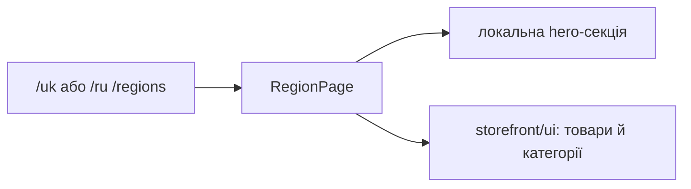

# Storefront: регіони

**Стан:** наявний маршрут і сторінка, звірено 2026-10-16.

`/uk|ru/regions` відкриває `RegionPage`. Вона складає локальну hero-секцію й повторно використовувані `InStockWorkwear` та `ProductCategories` зі `storefront/ui`. Бібліотека має додатковий рівень каталогу `regions/regions`; це фактичний шлях, а не новий модуль.

## Схема будови



## Структура в коді

```text
libs/storefront/feature/regions/
└── regions/src/lib/
    ├── pages/regions-page/
    │   └── region.page.ts # сторінка
    ├── sections/hero/
    │   └── hero.ts # локальний hero
    └── lib.routes.ts # маршрут
```

```text
libs/storefront/ui/
└── src/lib/sections/
    ├── in-stock-workwear/
    │   └── in-stock-workwear.ts # спільні товари
    └── product-categories/
        └── product-categories.ts # спільні категорії
```

**Де шукати:** [маршрут](../../../../libs/storefront/feature/regions/regions/src/lib/lib.routes.ts), [сторінка](../../../../libs/storefront/feature/regions/regions/src/lib/pages/regions-page/region.page.ts), [карта модулів](../../../architecture/storefront/modules.md).
