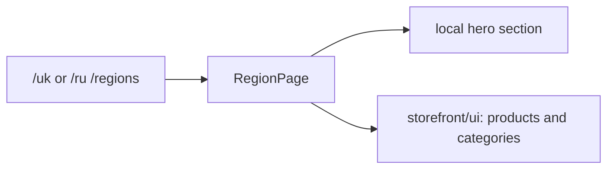

# Storefront: Regions

**Status:** route and page exist, checked 2026-10-16.

`/uk|ru/regions` opens `RegionPage`. It composes a local hero section and the
reusable `InStockWorkwear` and `ProductCategories` from `storefront/ui`. The
library has an additional nested `regions/regions` directory; this is the
actual path, not a new module.

## Structure diagram



## Code structure

```text
libs/storefront/feature/regions/
└── regions/src/lib/
    ├── pages/regions-page/
    │   └── region.page.ts # page
    ├── sections/hero/
    │   └── hero.ts # local hero
    └── lib.routes.ts # route
```

```text
libs/storefront/ui/
└── src/lib/sections/
    ├── in-stock-workwear/
    │   └── in-stock-workwear.ts # shared products
    └── product-categories/
        └── product-categories.ts # shared categories
```

**Where to look:** [route](../../../../libs/storefront/feature/regions/regions/src/lib/lib.routes.ts), [page](../../../../libs/storefront/feature/regions/regions/src/lib/pages/regions-page/region.page.ts), [module map](../../../architecture/storefront/modules.md).
