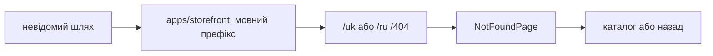

# Storefront: сторінка 404

**Стан:** реалізована, звірено 2026-10-16.

`notFoundRoutes` підключає локалізований `/uk|ru/404`; невідомі шляхи всередині мовного префікса перенаправляються туди. `NotFoundPage` показує локалізований текст, дає перейти до каталогу або назад; коли історії немає, повертає на локалізований початок. Зовнішній wildcard у `apps/storefront` спершу додає поточний мовний префікс.

## Схема будови



## Структура в коді

```text
libs/storefront/feature/not-found/
└── src/lib/
    ├── page/not-found-page/
    │   └── not-found.page.ts # сторінка
    └── lib.routes.ts # маршрут feature
```

```text
apps/storefront/
└── src/app/
    └── app.routes.ts # кореневі маршрути
```

**Де шукати:** [маршрут feature](../../../libs/storefront/feature/not-found/src/lib/lib.routes.ts), [сторінка](../../../libs/storefront/feature/not-found/src/lib/page/not-found-page/not-found.page.ts), [кореневі маршрути](../../../apps/storefront/src/app/app.routes.ts).
