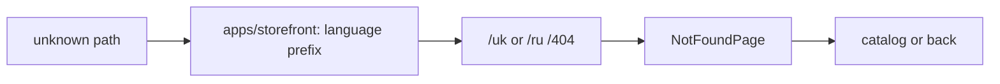

# Storefront: 404 Page

**Status:** implemented, checked 2026-10-16.

`notFoundRoutes` wires localized `/uk|ru/404`; unknown paths within a language
prefix redirect there. `NotFoundPage` shows localized text and provides links
to the catalog or back; if there is no history, it returns to the localized
home page. The outer wildcard in `apps/storefront` first adds the current
language prefix.

## Structure diagram



## Code structure

```text
libs/storefront/feature/not-found/
└── src/lib/
    ├── page/not-found-page/
    │   └── not-found.page.ts # page
    └── lib.routes.ts # feature route
```

```text
apps/storefront/
└── src/app/
    └── app.routes.ts # root routes
```

**Where to look:** [feature route](../../../libs/storefront/feature/not-found/src/lib/lib.routes.ts), [page](../../../libs/storefront/feature/not-found/src/lib/page/not-found-page/not-found.page.ts), [root routes](../../../apps/storefront/src/app/app.routes.ts).
