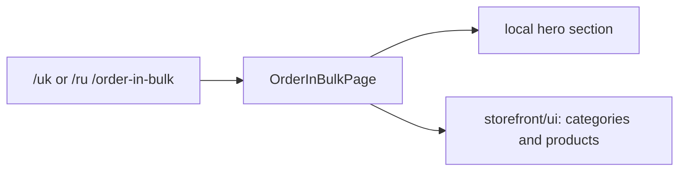

# Storefront: Bulk Order

**Status:** informational page exists, checked 2026-10-16; the route name alone
does not prove that order placement through an API exists.

`/uk|ru/order-in-bulk` opens `OrderInBulkPage`, which composes its own hero
section, `ProductCategories`, and `InStockWorkwear` from `storefront/ui`. The
library has a nested path `order-in-bulk/order-in-bulk`. Check order placement
scenarios separately from this page before documenting order integration.

## Structure diagram



## Code structure

```text
libs/storefront/feature/order-in-bulk/
└── order-in-bulk/src/lib/
    ├── page/order-in-bulk-page/
    │   └── order-in-bulk.page.ts # page
    ├── sections/hero/
    │   └── hero.ts # hero section
    └── lib.routes.ts # route
```

```text
libs/storefront/ui/
└── src/lib/sections/
    ├── in-stock-workwear/
    │   └── in-stock-workwear.ts # shared products
    └── product-categories/
        └── product-categories.ts # shared categories
```

**Where to look:** [route](../../../libs/storefront/feature/order-in-bulk/order-in-bulk/src/lib/lib.routes.ts), [page](../../../libs/storefront/feature/order-in-bulk/order-in-bulk/src/lib/page/order-in-bulk-page/order-in-bulk.page.ts), [hero section](../../../libs/storefront/feature/order-in-bulk/order-in-bulk/src/lib/sections/hero/hero.ts).
