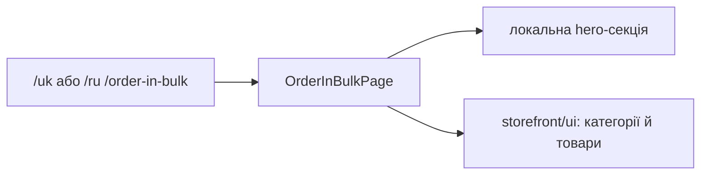

# Storefront: оптове замовлення

**Стан:** наявна інформаційна сторінка, звірено 2026-10-16; назва маршруту сама по собі не доводить наявність оформлення замовлення через API.

`/uk|ru/order-in-bulk` відкриває `OrderInBulkPage`, яка складає власну hero-секцію, `ProductCategories` і `InStockWorkwear` зі `storefront/ui`. Бібліотека має вкладений шлях `order-in-bulk/order-in-bulk`. Перевіряй сценарії оформлення окремо від цієї сторінки перед описом інтеграції із замовленнями.

## Схема будови



## Структура в коді

```text
libs/storefront/feature/order-in-bulk/
└── order-in-bulk/src/lib/
    ├── page/order-in-bulk-page/
    │   └── order-in-bulk.page.ts # сторінка
    ├── sections/hero/
    │   └── hero.ts # секція hero
    └── lib.routes.ts # маршрут
```

```text
libs/storefront/ui/
└── src/lib/sections/
    ├── in-stock-workwear/
    │   └── in-stock-workwear.ts # спільні товари
    └── product-categories/
        └── product-categories.ts # спільні категорії
```

**Де шукати:** [маршрут](../../../libs/storefront/feature/order-in-bulk/order-in-bulk/src/lib/lib.routes.ts), [сторінка](../../../libs/storefront/feature/order-in-bulk/order-in-bulk/src/lib/page/order-in-bulk-page/order-in-bulk.page.ts), [секція hero](../../../libs/storefront/feature/order-in-bulk/order-in-bulk/src/lib/sections/hero/hero.ts).
