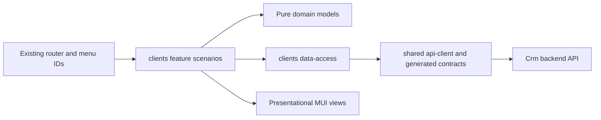

# Архітектура Admin React і карта файлів

Джерела правил: [доменна структура](../../../../../architecture/admin/structure/domains.md), [UI](../../../../../standards/admin/admin-ui.md), [delivery](../../../../../standards/shared/delivery-rules.md), [API workflow](../../../../../architecture/api/contract-workflow.md). Цей SDD використовує наявний Admin React/MUI, data router та RTK Query boundary. Storefront не змінюється; приватний Admin зберігає чинну політику noindex, окремий SEO-проєкт не потрібний.

## Домен і навігація

Використати передбачений архітектурою `libs/admin/clients/{feature,data-access,model,ui}`. Backend Crm не вимагає перейменовувати frontend domain на `crm`. Усередині кожного шару спочатку групувати за ролями (`pages`, `components`, `hooks`, `api`, `models`, `mappers`), усередині ролі — за можливостями `customers`, `quotes`, `custom-sewing`, `documents`; не створювати нову Nx library на кожну форму/DTO або порожні каталоги наперед. FE-EN-001 реєструє лише шари з реальною відповідальністю, public aliases `@admin/clients/<layer>`, project tags і dependency constraints.

| Існуючий ID   | Запланований маршрут  | Поведінка                                                                                                           |
| ------------- | --------------------- | ------------------------------------------------------------------------------------------------------------------- |
| clients       | `/crm/clients`        | Список, створення; detail `/crm/clients/:customerId`, edit як стан сторінки/окрема дочірня форма за чинним патерном |
| quotes        | `/crm/quotes`         | Список, `/crm/quotes/new`, `/crm/quotes/:quoteId`, перегляд вибраної version через query/child route                |
| quote-archive | `/crm/quotes/archive` | Та сама функція списку з початковим архівним фільтром, не дубль модуля                                              |

Client і quote list/new/detail/history/archive маршрути реалізовано. Archive menu використовує ту саму QuotesPage з archivedView; history зберігає version/versionPage/eventPage/compare у URL. Custom editor/issuer/templates залишаються наступними фазами.

## Межі та карта відповідальностей

| Шлях                                                                                                | Стан / одна відповідальність                                                                                    |
| --------------------------------------------------------------------------------------------------- | --------------------------------------------------------------------------------------------------------------- |
| `apps/admin-react/src/app/router/{legacy-menu.ts,admin-route-definitions.tsx,navigation-config.ts}` | Існуючі, мінімальне підключення; не перетворювати на каталог бізнес-компонентів                                 |
| `libs/admin/clients/feature/src/clients.routes.tsx`                                                 | Реалізований route composition через public exports                                                             |
| `feature/src/pages/customers/{list,detail,create}/ та `hooks/{customers,contacts,merge}/`           | Окрема сторінка/сценарій, локальний orchestration hook і form state; не HTTP                                    |
| `feature/src/{pages,components,hooks}/quotes/`                                                      | Сценарії окремо, редактор компонує секції, не містить усіх форм/запитів/формул в одному файлі                   |
| `feature/src/{pages,components,hooks}/custom-sewing/`                                               | Чернетка, варіанти й явне застосування шаблону/підказки                                                         |
| `feature/src/{pages,components,hooks}/documents/`                                                   | Окремі реквізити/PDF/send/package сценарії                                                                      |
| `data-access/src/{api,models,mappers,validators,cache,errors}/`                                     | Операційні запити, runtime перевірка DTO, mapping/cache, без JSX/маршрутів                                      |
| `model/src/{entities,models,queries,mappers,validators}/`                                           | Чисті domain/view models, state transitions, нормалізація форми без React/HTTP/generated DTO                    |
| `ui/src/{components,forms,tables}/`                                                                 | MUI presentation/props, таблиці, item/variant sections, version diff, tier visibility, file states; без запитів |
| `libs/admin/clients/<layer>/src/index.ts`, `project.json`, `tsconfig.base.json`                     | Public API, реальні Nx targets/tags/aliases, без deep imports                                                   |
| `libs/admin/shared/contracts/`, `tools/contracts/`                                                  | Існуючі генерація/синхронізація; generated файли вручну не правити                                              |

Один компонент/hook/mapper/interface має власний файл за змістом. Секції quote item, variant tier, calculation comparison, contact channels і file row не ховати у величезній editor page. Водночас не створювати загальні `helpers`, `common`, `misc` або беззмістовні wrapper folders. Імена конкретних файлів фіксуються в atomic task до коду, сусідні патерни й lint constraints є пріоритетними.

## Стан, кеш і форми

Серверні дані — RTK Query; URL — застосовані пошук/фільтри/page/archive/version; локальна форма — незбережений ввід/dirty/помилки. Не дублювати DTO у Redux та локальному state без потреби. data-access перевіряє й перетворює operation-specific generated DTO в чисту model. UI/feature не імпортує generated DTO напряму.

Save/reprice/transfer/archive invalidates точний detail/version/list scope; оновлення клієнта не переписує recipient snapshot у quote cache. Після передачі очистити недоступний detail і перейти до доступного списку. Не оптимістично змінювати виданий документ/ціну чи ownership до server success. Пошук debounce/cancel, stale result не перетирає актуальний запит.

Зберігати requestId для повтору одного логічного payload; змінений payload — нова дія. expectedRevision читається з detail і не підвищується у браузері. 409 показує compare/reload без втрати форми; 422 прив'язується до поля/blocker; 401 — чинний auth flow; 403/404 — захищена сторінка. Dirty navigation guard використовує підтримуваний data router (`useBlocker` за чинним патерном), не глобальне перехоплення всіх переходів. Невідомий результат запису уточнюється повтором того ж requestId, не подвійним створенням.

Усі рядки й accessible names українською, компоненти/тема MUI існуючі. Порожній список не є помилкою. Під час реалізації додати актуальну коротку карту `docs/features/admin/clients-and-quotes.md` з реальними routes/files/diagram та індекс; planned-файли цього SDD не видавати за implemented.

## Поточна реалізація клієнтів

Фактичні customer, P2 та P3 paths описано в [implemented feature map](../../../../../features/admin/clients-and-quotes.md). History, lifecycle writes і reprice мають окремі scenario hooks; copy/transfer/archive — окремі діалоги. Custom/document paths — target design. Generated DTO доступні лише data-access; model/UI не виконують HTTP. Access loss очищає protected admin API cache; звичайні записи інвалідують точний корінь і список.

[Структурний аудит](../code-audit/audit.md) уточнює поточний client slice: сторінки/діалоги компонують UI, hooks керують формою й мутаціями; API query/customer/contact/merge builders збираються одним endpoint registration. Public aliases, контракт та URL не змінено.
