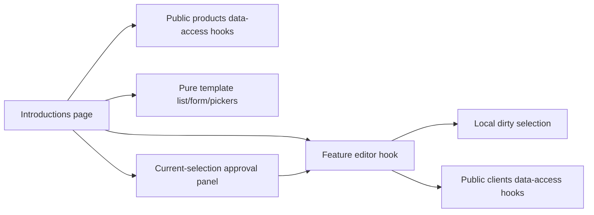

# FE-011 feature screen integration — 2026-10-30

## Delivered scope

Additive route `/crm/quotes/introductions` is reachable from the existing quote list. The feature page composes the owned-template list, form, seasonal selection panel and model/article pickers. It consumes only public data-access hooks and model types pinned to backend `e16b73d38d4c3ba149cf6253dcf3f2a70dc14f9d`.

Existing saved templates can be listed/opened, revised, archived/restored, checked using the exact saved version, and applied into a new quote draft with an explicit recipient. The resulting existing QuoteDetail publicId routes to the ordinary quote editor/ready/PDF flow. No send is triggered.

Local slot/name/email/format edits mark the selection dirty and require explicit save before server approval or apply. Check uses a fresh lazy query with `preferCacheValue=false`; local selection and active-mapping versions form the approval identity. Per-slot validation identifiers are shown as concrete Ukrainian blockers. Position one offers only the exact configured featured product. Other candidates are bounded paged Catalog sewing results; the page states that season and availability are verified by the server.

Writes reuse `useTemplateAction`: request ID and body are captured once for retry after an uncertain result, and input is disabled until that result is resolved. Protected detail/check errors clear the previous local draft; list access denial immediately hides stale content and resets it. Missing featured mapping remains a configuration blocker and does not create a cache-reset loop.

## Boundaries

```text
feature/src/pages/introductions/
  introductions-page.tsx                 route composition and Catalog picker queries
feature/src/hooks/introductions/
  use-introduction-draft.ts              local editable values/slots and dirty identity
  introduction-editor-values.ts          saved model to local state; typed slot writes
  use-introduction-editor.ts             owned template API workflow and stable write retry
  introduction-error-message.ts          concrete server blocker presentation
```



No generated DTO or raw transport is imported into feature. New model/UI/data-access files are covered by their respective contributor evidence.

## Verification

- Feature lib and spec TypeScript checks passed during integration.
- Hook lifecycle and quote-list regression tests passed **8/8**; page composition test passed **1/1**. Final fresh combined rerun passed **9/9**, zero failed, after the access-denial guard.
- Prettier write completed for all changed feature files.
- Scoped ESLint passed after correcting a single import-order issue; no runtime edit followed the final tests.

Tests: `npx vitest run src/hooks/introductions/use-introduction-editor.unit.test.tsx src/pages/introductions/introductions-page.component.test.tsx src/pages/quotes/list/quotes-page.component.test.tsx` from the feature library.

## Explicit remaining boundary

The backend contract requires an emailTemplateVersionId, but there is no approved discovery/source workflow for a new email-template reference. The form reuses a reference already present in a saved template. New-template save stays disabled without an approved reference rather than inventing a UUID or treating issuer document-template identity as email-template identity. User confirmed on 2026-10-30 that new-template creation stays blocked until P6. This is an agreed deferral, not a pending source decision; existing saved references remain usable. Full FE-011 acceptance is not claimed. Actual seasonal PDF visual/privacy and explicit-send acceptance remain separate.
