# Visual guidance for React Admin

The user provided twenty-two images as examples of lists, forms, menus, headers, and separate detail pages. [All original attachments and their new names](assets/visual-references/README.md) are stored in the repository. They illustrate the composition: a prominent heading, a light table surface, a clear toolbar, separated rows, a visible create action, a clear current item in dark navigation, and a compact header. Forms group fields by meaning and show errors beside the field. Detail pages provide a way back.

For new create/edit/detail pages, place every field and data item on white MUI `Card` or `Paper` surfaces rather than directly on the page background. Split large amounts of information into semantic sections. Sections may sit side by side on wide screens and stack in one column on narrow screens. Create and edit use the same form structure: create starts with empty editable fields; edit loads current values. Detail is read-only and includes a link to edit.

This is **presentation guidance**, not the Brevi data model or proof that a feature exists. Do not adopt Customers/Products names, avatars, quotas, statuses, SKU, stock, import/export, languages, notifications, payments, rich-text editors, or invented records without a separate backend contract and feature SDD. The interface remains in Ukrainian and uses the Brevi corporate theme from the [shell feature](shell/001-react-admin-shell-theme/README.md).

For existing reference data, use MUI Material and the free `@mui/x-data-grid` package, which is already in `package.json`. Preserve the four old pages and plan their six tables as separate features. On the two paired pages, tabs represent different tables, not new main-menu items. The toolbar should show only actions implemented for that table; the Angular context menu may be replaced with an accessible MUI row menu without changing business behavior. After migrating each feature, check both themes and narrow/wide screens.

## Menu and header

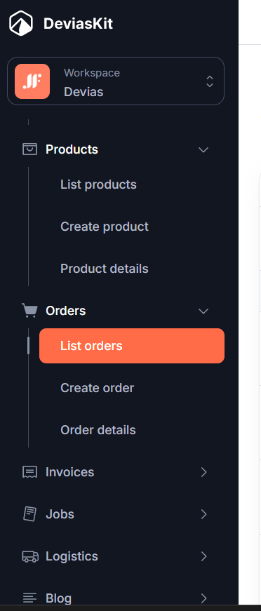

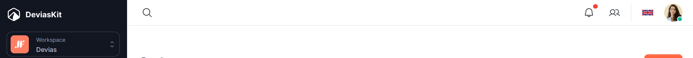

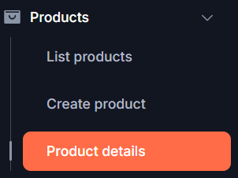

## Tables

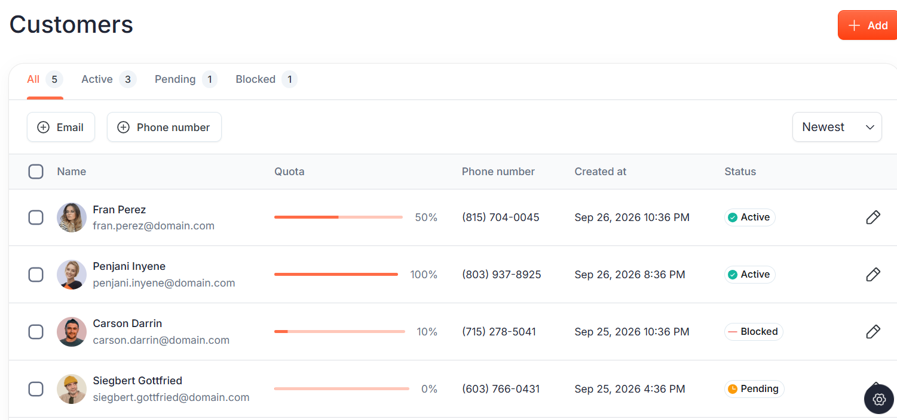

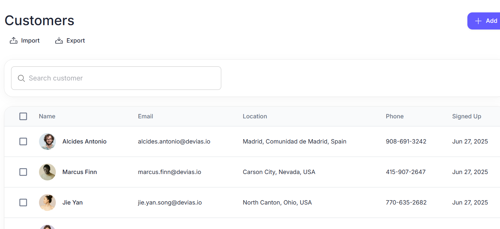

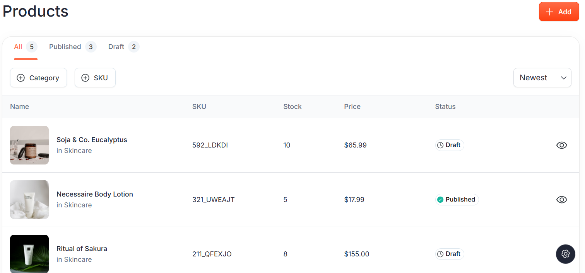

## Forms and details

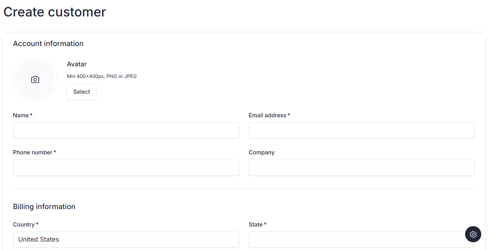

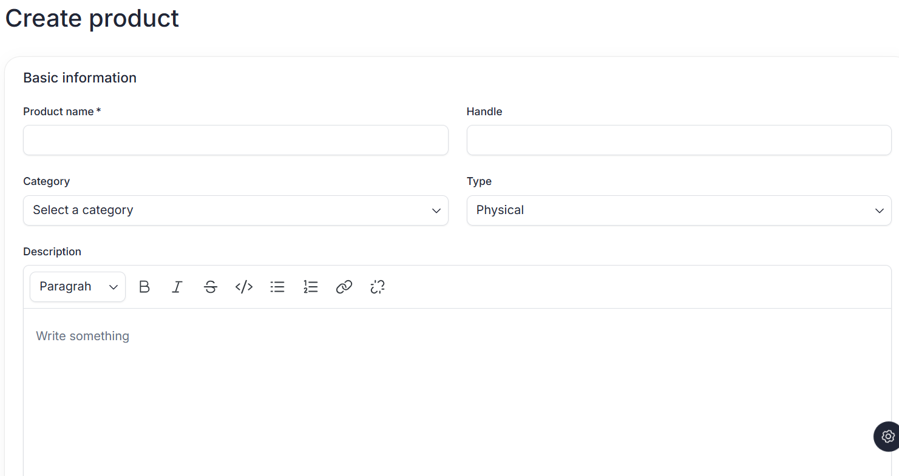

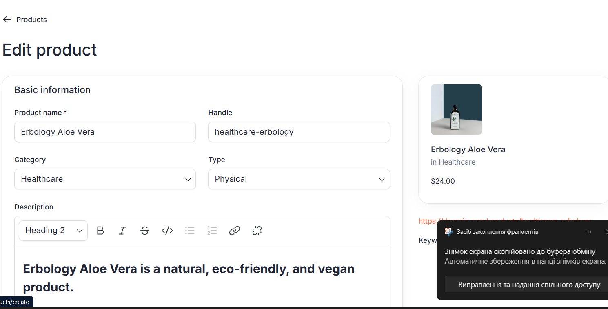

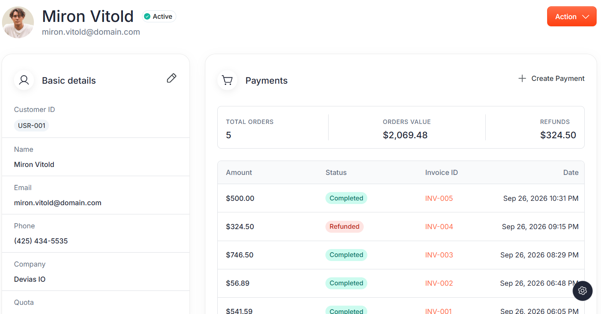

### Separate detail pages

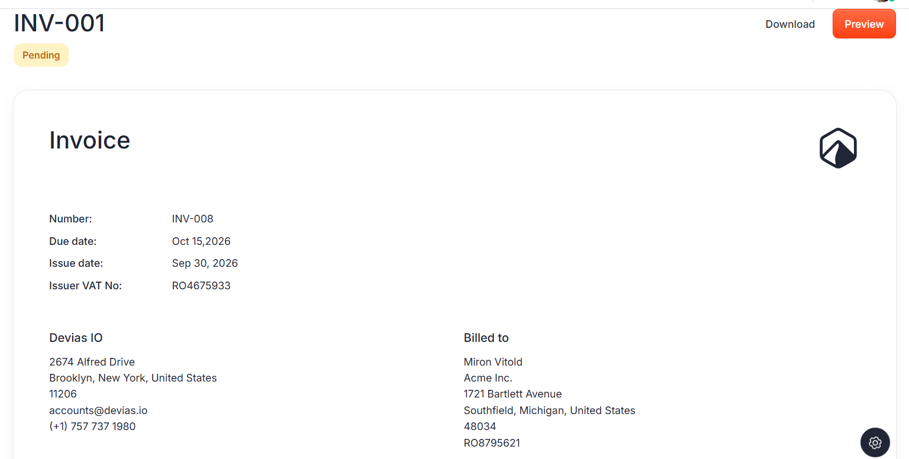

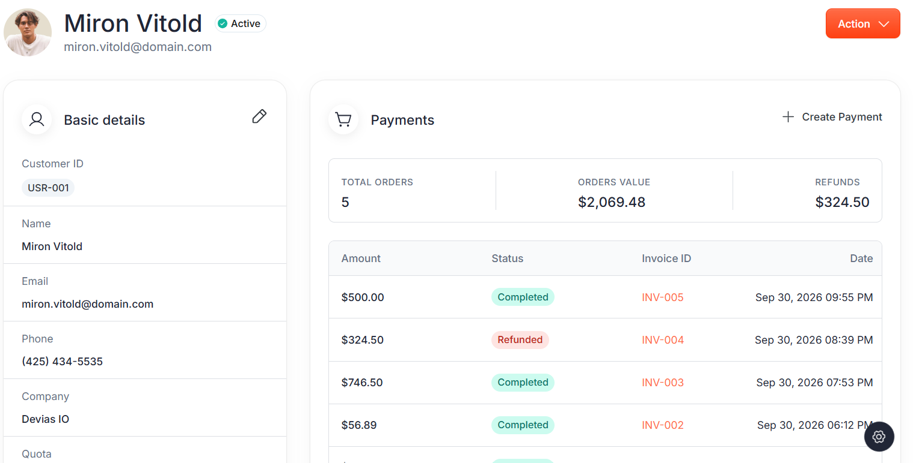

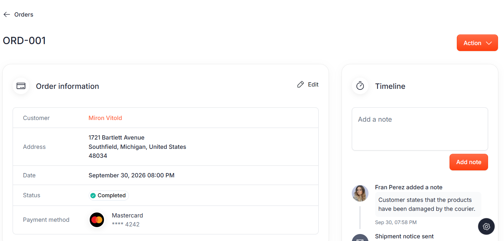

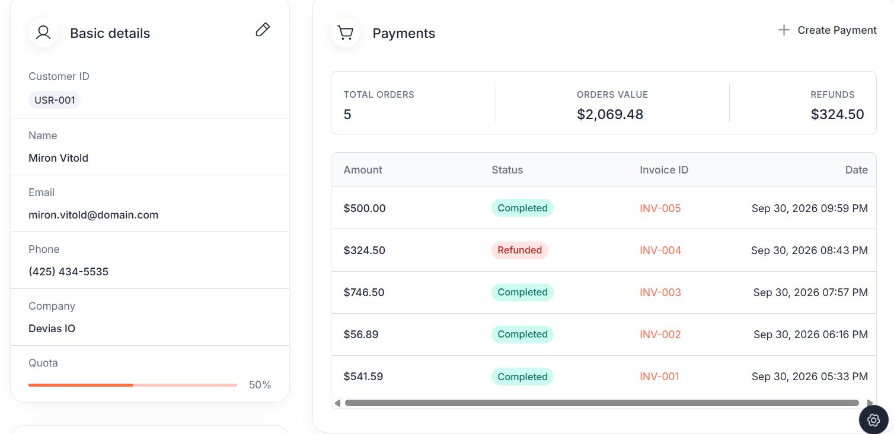

### Create and edit pages

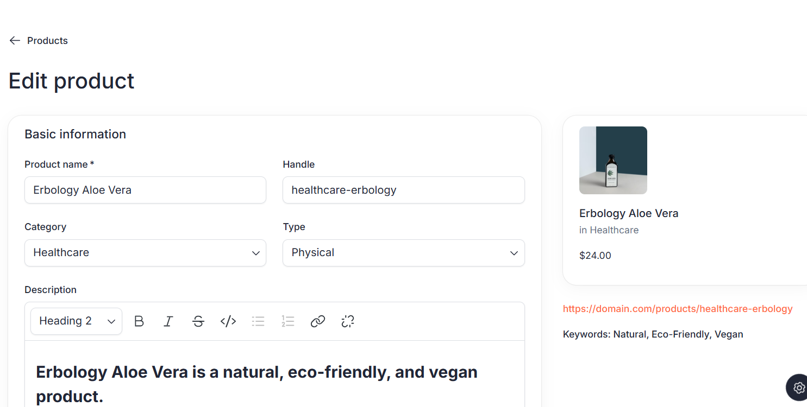

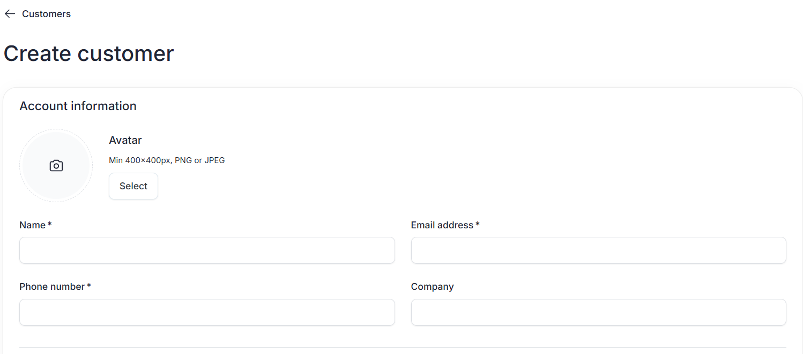

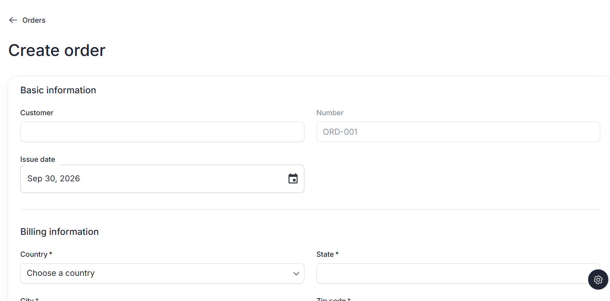

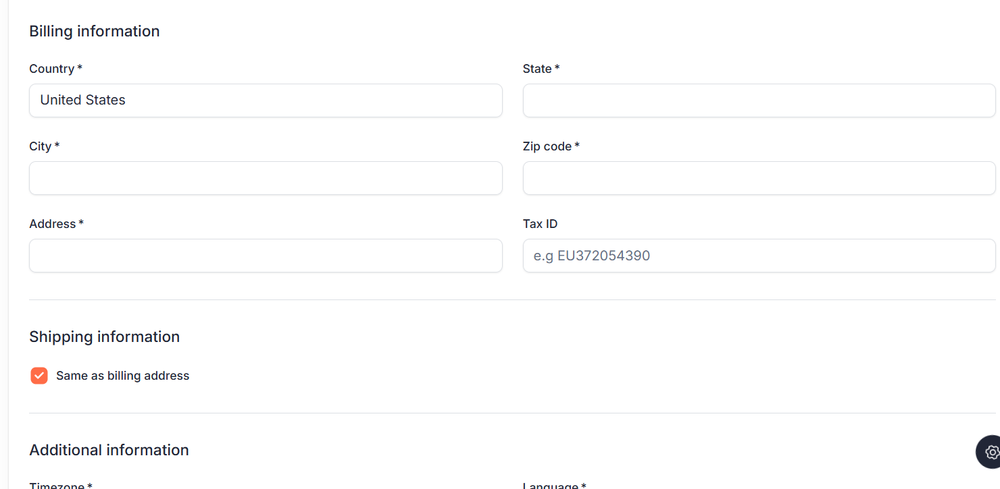

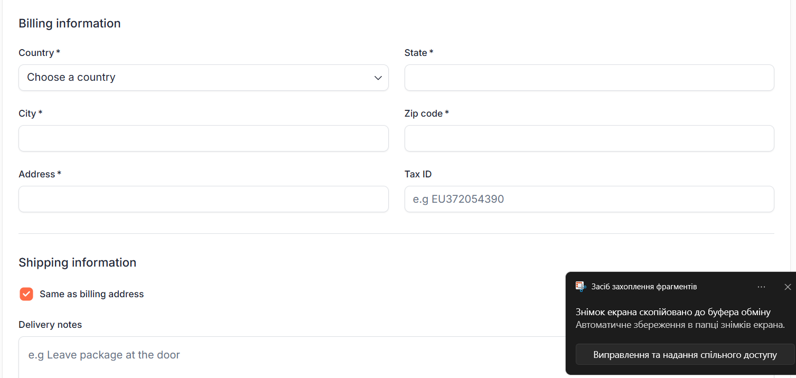

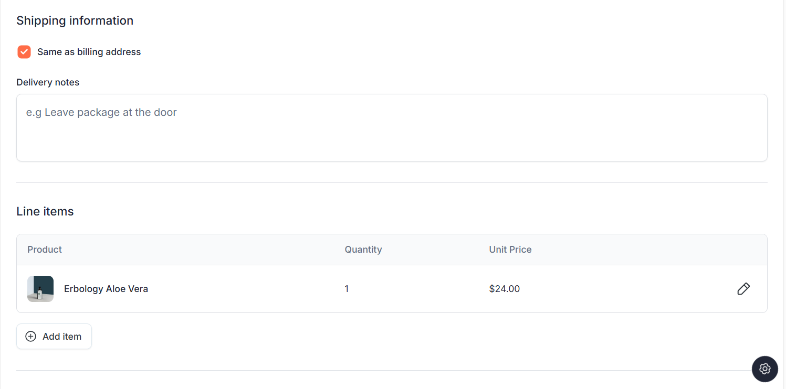

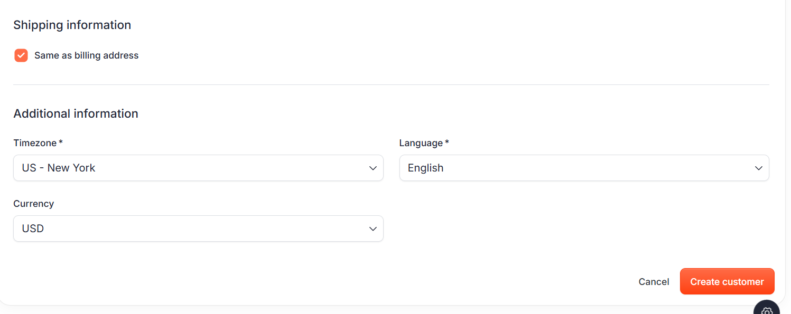

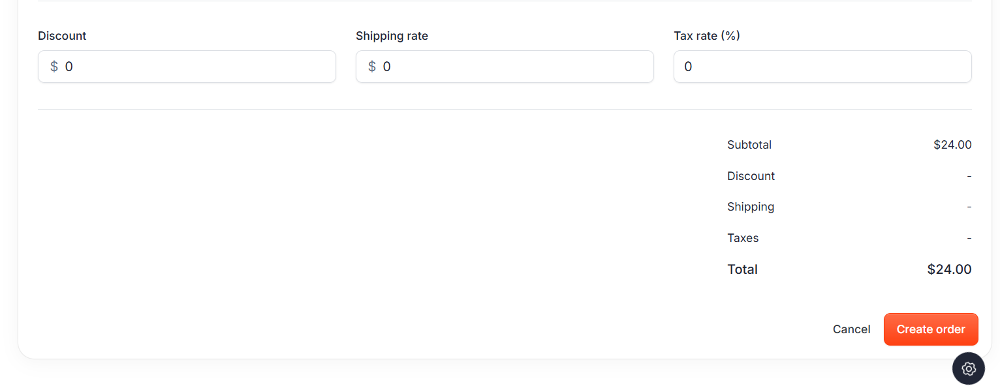
